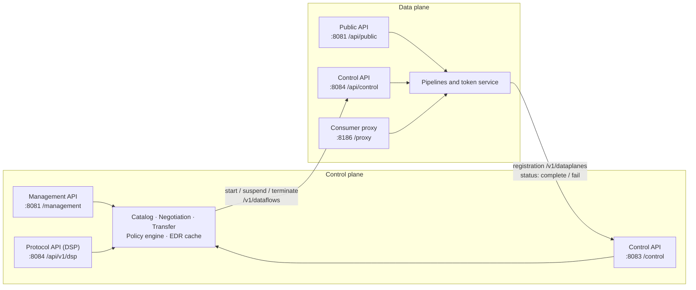

# Components

A Tractus-X EDC connector consists of a **control plane** and one or more **data planes**, plus external services for
state, secrets and identity.

Ports and paths are the [Helm chart defaults](../deployment/helm-chart.md#ports-and-paths).

## Control plane

The control plane is the "brain". It never touches the data itself.

**It is responsible for:**

- **Catalog.** Builds the catalog a requesting partner may see, by evaluating the access policy of every contract
  definition.
- **Contract negotiation.** Runs the negotiation state machine as consumer or provider and stores agreements.
- **Transfer process.** Starts, suspends and terminates transfers; asks a data plane to do the work.
- **Policy engine.** Evaluates ODRL policies with the Catena-X constraint functions. See [Catena-X policies](policies.md).
- **Identity.** Obtains tokens from the STS, requests and verifies verifiable presentations, resolves BPNs and DIDs via
  BDRS. See [Identity and trust](identity-and-trust.md).
- **EDR cache.** Stores the endpoint data references (EDRs) it receives as a consumer and refreshes their tokens. See
  [EDRs and token refresh](edr-and-token-refresh.md).

**Its APIs:**

| API | Audience | Exposure |
|---|---|---|
| Management API | Your own applications | Internal only; protected by an API key or delegated (JWT) auth |
| Protocol API (DSP) | Partner connectors | Public, via TLS ingress |
| Control API | Your data planes | Internal only |
| Default API (`/api/check/*`) | Kubernetes probes | Internal only |

## Data plane

The data plane is the "muscle". It moves data, or proxies requests to your backend.

**It is responsible for:**

- **Provider pull (HTTP).** Its **public API** accepts requests from consumers that present a valid access token and
  proxies them to the asset's backend.
- **Provider push.** Pushes data to a destination given by the consumer (HTTP, AWS S3, Azure Blob Storage).
- **Tokens.** Issues the access token and refresh token of each EDR and serves the **refresh endpoint**
  (`POST /token` on the public API).
- **Consumer proxy.** A convenience API (`POST /proxy/aas/request`) that lets your applications fetch provider data
  using the EDRs cached in your own control plane.
- **Non-finite push.** Keeps push flows open and re-pushes on demand (`POST /v3/dataflows/{id}/trigger` on the data
  plane's management context).

**How it connects to the control plane:**

1. At startup the data plane **registers itself** at the control plane's selector (`/v1/dataplanes`), announcing the
   source and transfer types it supports.
2. When a transfer starts, the control plane calls the data plane's signaling API (`/v1/dataflows`).
3. When a push transfer ends, the data plane reports `complete` or `fail` back to the control plane.

## The runtimes

| Runtime | Contains | Stores | Vault |
|---|---|---|---|
| `edc-controlplane-postgresql-hashicorp-vault` | Control plane | PostgreSQL | HashiCorp Vault |
| `edc-dataplane-hashicorp-vault` | Data plane | PostgreSQL | HashiCorp Vault |
| `edc-runtime-memory` | Control plane **and** data plane in one JVM | In memory | In memory, single participant |

Both production runtimes are built from shared base modules (`edc-controlplane-base`, `edc-dataplane-base`). See
[Code architecture](../developer/code-architecture.md).

## External dependencies

| Dependency | Used by | For |
|---|---|---|
| PostgreSQL | Control plane, data plane | All state: assets, policies, negotiations, transfers, EDRs, tokens |
| HashiCorp Vault | Control plane, data plane | Secrets: STS client secret, token signing keys, credentials of data addresses |
| Credential service (wallet) and STS | Control plane, data plane | Self-issued tokens and verifiable presentations (DCP) |
| BDRS | Control plane | Mapping BPNs to DIDs and back |
| OpenTelemetry collector (optional) | Both | Traces, metrics and business events |

## What Tractus-X adds

Compared to a plain upstream EDC, the Tractus-X runtimes add, among others:

- the **Catena-X policy functions** (`cx-policy`) and policy validation at creation time;
- **business partner groups** and the `/v3/business-partner-groups` API;
- the **BDRS client** for BPN ↔ DID resolution;
- the **EDR API** `/v3/edrs` (negotiate and transfer in one call, cached and refreshed tokens);
- **token refresh** on the provider data plane and in the consumer;
- the **DSP 0.8 backport** for downward compatibility;
- **connector discovery** `/v3/connectordiscovery`;
- **agreement retirement** `/v3/contractagreements/retirements`;
- the **DIV** STS client and DID document service self-registration.

The [extension catalogue](../reference/extensions.md) lists every module.

## NOTICE

This work is licensed under the [CC-BY-4.0](https://creativecommons.org/licenses/by/4.0/legalcode).

- AI Disclosure: This file was entirely AI-generated. The AI-generated portions are made available under CC0-1.0 and
  not subject to the project's license. The human contributor has reviewed and verified that the content is correct.
- SPDX-License-Identifier: CC-BY-4.0 AND CC0-1.0
- SPDX-FileCopyrightText: 2026 Catena-X Automotive Network e.V.
- SPDX-FileCopyrightText: 2026 Contributors to the Eclipse Foundation
- Assisted-By: GitHub Copilot (claude-opus-5.5)
- Source URL: <https://github.com/eclipse-tractusx/tractusx-edc>
