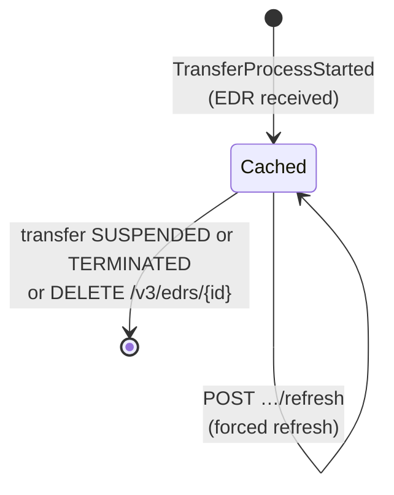
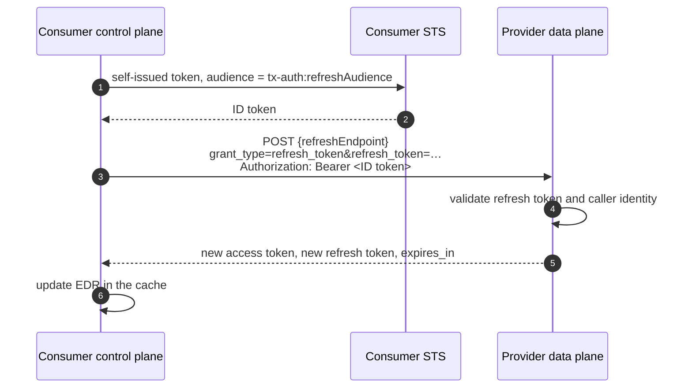

# EDRs and token refresh

An **Endpoint Data Reference (EDR)** is what a consumer receives when a pull transfer starts: the address of the
provider's data plane and a short-lived **access token** to call it. Tractus-X EDC caches EDRs for you and keeps their
tokens fresh, so your applications can keep using a transfer for as long as the agreement allows.

## What an EDR looks like

```json
{
  "@type": "DataAddress",
  "type": "https://w3id.org/idsa/v4.1/HTTP",
  "endpoint": "https://provider-data.plane/api/public",
  "authorization": "eyJ…",
  "tx-auth:refreshEndpoint": "https://provider-data.plane/api/public/token",
  "tx-auth:refreshToken": "eyJ…",
  "tx-auth:expiresIn": "300",
  "tx-auth:refreshAudience": "did:web:provider.example.com"
}
```

| Field | Meaning |
|---|---|
| `endpoint` | Base URL of the provider data plane's public API |
| `authorization` | Access token. Send it as the `Authorization` header |
| `tx-auth:expiresIn` | Token lifetime in seconds (provider default 300) |
| `tx-auth:refreshEndpoint` | Where to exchange the refresh token for a new token pair |
| `tx-auth:refreshToken` | One-time refresh token |
| `tx-auth:refreshAudience` | Audience for the self-issued token that authenticates the refresh request |

The `tx-auth` prefix stands for `https://w3id.org/tractusx/auth/`. The EDR, including its tokens, is stored in the
consumer's **Vault**; the cache index lives in the database.

## The lifecycle



The EDR follows its transfer process: as long as the transfer is `STARTED`, the EDR is in the cache. When the transfer
is suspended or terminated, the EDR is removed automatically.

## Getting a valid token

| Call | Behaviour |
|---|---|
| `GET /v3/edrs/{transferProcessId}/dataaddress` | Returns the EDR. With `auto_refresh=true` (the default) the token is refreshed first if it has expired or is about to. With `auto_refresh=false` it is returned as is. |
| `POST /v3/edrs/{transferProcessId}/refresh` | Forces a refresh and returns the new EDR. |
| `POST /proxy/aas/request` on the **consumer** data plane | Looks up the EDR (by `assetId` + `providerId`, or `transferProcessId`), refreshes it if needed and fetches the data for you. |

Concurrent refreshes of the same EDR are serialised with a database row lock, so several application instances can
share one connector safely.

## How a refresh works



The refresh token is **rotated** on each refresh. The previous token stays valid until the new one is used for the
first time, so a lost response does not break the flow (see
[ADR: refresh token retire on acknowledgement](../development/decision-records/2026-08-10-refresh-token-retire-on-acknowledgement/README.md)).

## Provider-side settings

| Helm value | Setting | Default (chart) | Meaning |
|---|---|---|---|
| `dataplane.token.refresh.expiry_seconds` | `tx.edc.dataplane.token.expiry` | 300 | Access token lifetime |
| `dataplane.token.refresh.expiry_tolerance_seconds` | `tx.edc.dataplane.token.expiry.tolerance` | 10 | Clock skew tolerance |
| `dataplane.token.refresh.refresh_endpoint` | `tx.edc.dataplane.token.refresh.endpoint` | `<public URL>/token` | Refresh endpoint put into EDRs |
| `dataplane.token.signer.privatekey_alias` | `edc.transfer.proxy.token.signer.privatekey.alias` | – | Vault alias of the signing key |
| `dataplane.token.verifier.publickey_alias` | `edc.transfer.proxy.token.verifier.publickey.alias` | – | Vault alias of the verification key |

## Further reading

- [EDR walkthrough](../usage/management-api-walkthrough/07_edrs.md): every request in detail
- [Data plane signaling extensions](../development/dataplane-signaling/tx-signaling.extensions.md): the design of
  token refresh in data plane signaling
- [ADR: token refresh](../development/decision-records/2024-03-05_token_refresh/README.md)
- [Tutorial 3: consume data with EDRs](../tutorials/consume-with-edrs.md)

## NOTICE

This work is licensed under the [CC-BY-4.0](https://creativecommons.org/licenses/by/4.0/legalcode).

- AI Disclosure: This file was entirely AI-generated. The AI-generated portions are made available under CC0-1.0 and
  not subject to the project's license. The human contributor has reviewed and verified that the content is correct.
- SPDX-License-Identifier: CC-BY-4.0 AND CC0-1.0
- SPDX-FileCopyrightText: 2026 Catena-X Automotive Network e.V.
- SPDX-FileCopyrightText: 2026 Contributors to the Eclipse Foundation
- Assisted-By: GitHub Copilot (claude-opus-5.5)
- Source URL: <https://github.com/eclipse-tractusx/tractusx-edc>
