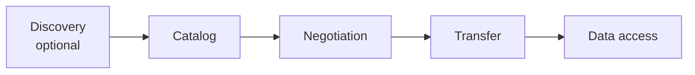
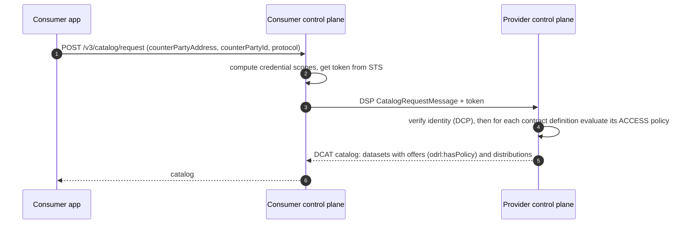
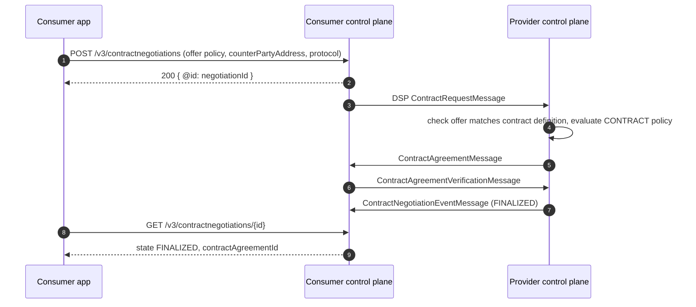
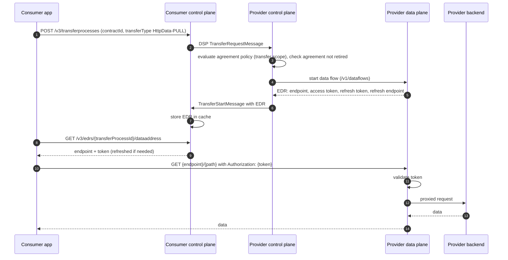
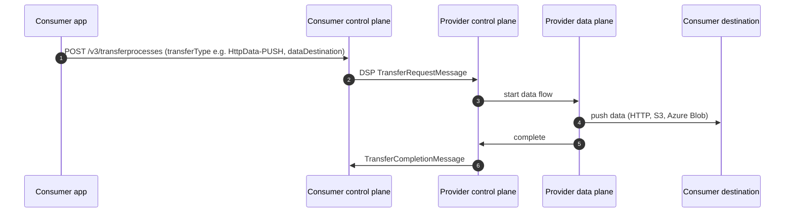
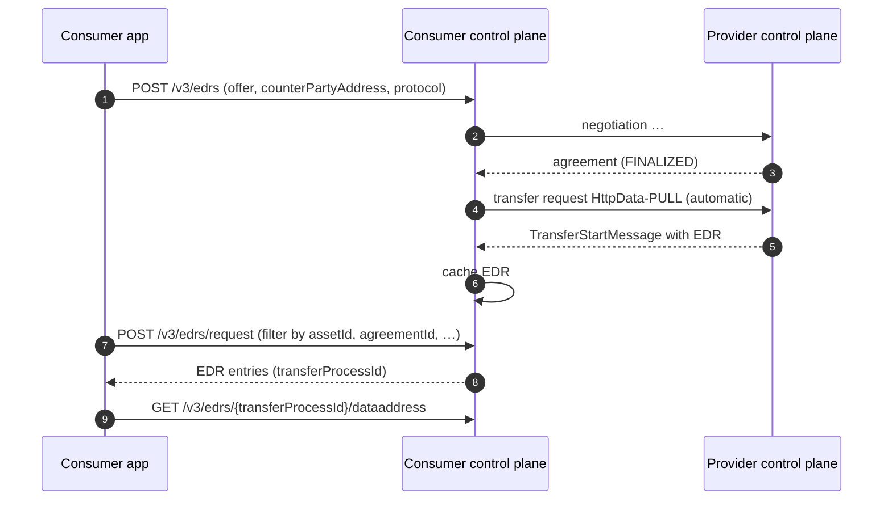
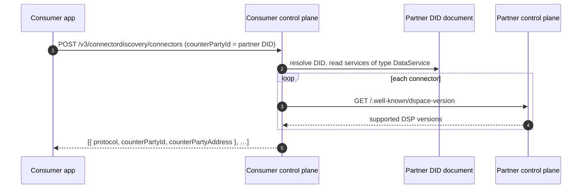

# Data exchange flows

This page shows, as sequence diagrams, what happens between the control planes and data planes of consumer and
provider. Identity checks (see [Identity and trust](identity-and-trust.md)) happen on every DSP call and are drawn only
once.

## Catalog

The offers contain the **contract policy**. Distributions tell you the transfer types the provider supports, such as
`HttpData-PULL`, `HttpData-PUSH`, `AmazonS3-PUSH` or `AzureStorage-PUSH`.

## Contract negotiation

The negotiation is **asynchronous**: poll its state, or register a callback. Both sides store the agreement, and
Tractus-X EDC also records the BPNs of both parties with it.

## Transfer: consumer pull (HTTP)

The most common pattern in Catena-X. The provider data plane becomes a protected proxy in front of the provider's
backend, and the consumer receives an **EDR** (endpoint + token).

The transfer stays in state `STARTED` until it is terminated or suspended, or until the policy monitor ends it (for
example when `DataUsageEndDate` is reached). Tokens are short-lived and **refreshed**; see
[EDRs and token refresh](edr-and-token-refresh.md).

## Transfer: provider push

**Non-finite push.** If the asset's data address has `"isNonFinite": "true"`, the flow stays open after the first push.
The provider re-pushes the full current content with `POST /v3/dataflows/{transferProcessId}/trigger` on the
**data plane** management API. See the
[walkthrough](../usage/management-api-walkthrough/10_nonfiniteproviderpush/10_nonfiniteproviderpush.md).

## One call: negotiate and transfer with the EDR API

`POST /v3/edrs` starts a negotiation; when it is finalized, the connector automatically starts an `HttpData-PULL`
transfer and caches the resulting EDR.

## Connector discovery

Before the first catalog request you need the partner's DSP address and protocol version.

For a single known address, `POST /v3/connectordiscovery/dspversionparams` returns the parameters to use directly. A
partner that only speaks DSP 0.8 is detected too, and you get its BPNL as `counterPartyId`.

## Agreement retirement

A provider can **retire** an agreement before its natural end with
`POST /v3/contractagreements/retirements`. New transfers for it are rejected and the policy monitor terminates running
ones. `DELETE /v3/contractagreements/retirements/{agreementId}` reactivates it. See the
[agreements README](../../edc-extensions/agreements/README.md).

## NOTICE

This work is licensed under the [CC-BY-4.0](https://creativecommons.org/licenses/by/4.0/legalcode).

- AI Disclosure: This file was entirely AI-generated. The AI-generated portions are made available under CC0-1.0 and
  not subject to the project's license. The human contributor has reviewed and verified that the content is correct.
- SPDX-License-Identifier: CC-BY-4.0 AND CC0-1.0
- SPDX-FileCopyrightText: 2026 Catena-X Automotive Network e.V.
- SPDX-FileCopyrightText: 2026 Contributors to the Eclipse Foundation
- Assisted-By: GitHub Copilot (claude-opus-5.5)
- Source URL: <https://github.com/eclipse-tractusx/tractusx-edc>
