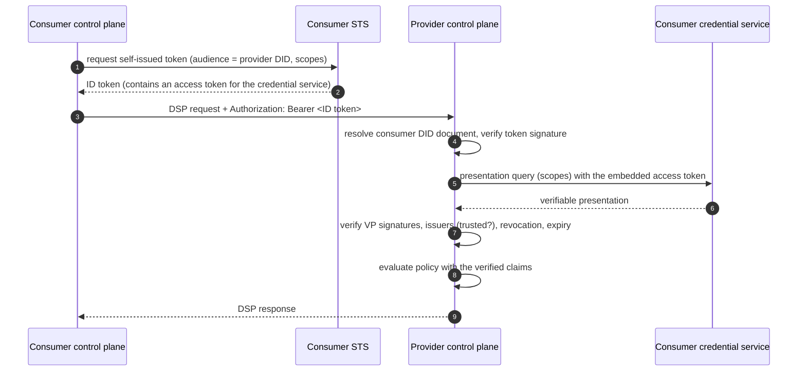

# Identity and trust

A connector must answer two questions on every request it receives: **who is calling**, and **what is the caller
allowed to do**. Tractus-X EDC answers both with decentralized identity: DIDs, verifiable credentials and the
[Decentralized Claims Protocol (DCP)](https://eclipse-dataspace-dcp.github.io/decentralized-claims-protocol/).

## The actors

| Actor | What it is | In Tractus-X EDC |
|---|---|---|
| **DID** | The connector's identifier, e.g. `did:web:connector.example.com`. Resolves to a DID document with keys and service endpoints. | `participant.id` (setting `edc.participant.id`) |
| **BPNL** | The Catena-X business partner number of the company. | `participant.bpnl` (setting `tractusx.edc.participant.bpn`) |
| **Credential service** (wallet) | Holds the company's verifiable credentials and creates verifiable presentations (VPs). | External. Found through the DID document. |
| **STS** | Secure Token Service. Issues **self-issued ID tokens** the connector attaches to its DSP requests. | External; reached via OAuth2 client credentials (`dcp.sts.oauth.*`). A **DIV** flavour is used when `dcp.sts.div.url` is set. |
| **Trusted issuers** | The DIDs whose credentials you accept. | `dcp.trustedIssuers` |
| **BDRS** | BPN-DID Resolution Service: a directory mapping BPNLs to DIDs. | `controlplane.bdrs.server.url` |

## The Catena-X credentials

| Credential | Says that… | Requested when |
|---|---|---|
| `MembershipCredential` | the company is a Catena-X member | Always (default scope) |
| `DataExchangeGovernanceCredential` | the company signed the data exchange governance framework agreement | Default scope for DSP 2025-1; checked by the `FrameworkAgreement` constraint |
| `BpnCredential` | the DID belongs to this BPNL | Default scope for DSP 2025-1 |
| Others (e.g. `DismantlerCredential`) | special roles | When a policy references them |

The connector derives the scopes it asks for from two sources: **default scopes** per DSP version, and the **left
operands** of the policies being evaluated (for example `FrameworkAgreement` → `DataExchangeGovernanceCredential`).
Scopes have the form `org.eclipse.tractusx.vc.type:<CredentialType>:read`.

## How a DSP request is authenticated

**Verifiable presentation cache.** To avoid querying the credential service on every request, the provider caches
VPs. Configure with `dcp.cache.enabled` (default `true`) and `dcp.cache.validity` (seconds, default `86400`).

## BPN ↔ DID resolution with BDRS

Catena-X policies and many applications speak in BPNLs, while DSP 2025-1 identifies participants by DID. The
**BDRS client** bridges the two:

- It downloads the BPN directory from `{bdrs}/bpn-directory`, authenticated with the connector's own
  **Membership** VP, and caches it (`controlplane.bdrs.cache_validity_seconds`, chart default 600).
- When you address a partner by BPNL, the connector maps it to the DID **audience** of the outgoing token.
- When a policy checks BPNs (for example `BusinessPartnerGroup`), the connector maps the caller's DID to its BPNL.

## Participant identity per protocol version

| DSP version | Protocol id | Participant identity |
|---|---|---|
| 2025-1 | `dataspace-protocol-http:2025-1` | DID |
| 0.8 (legacy) | `dataspace-protocol-http` | BPNL, taken from the `holderIdentifier` of the Membership credential |

The legacy DSP 0.8 sends the `Authorization` header without a `Bearer` prefix. The `token-interceptor` extension adds or
strips the prefix so that both versions work side by side.

## Publishing your connector in your DID document

Partners discover your connector through the `DataService` entry in your DID document. With
`dcp.didService.selfRegistration.enabled: true`, the control plane adds this entry at startup (pointing to your DSP
`/.well-known/dspace-version` endpoint) and, for single-replica deployments, removes it at shutdown. The entry id is
derived from the participant context id. The DIV implementation updates the DID document through the DIV wallet API.

## Settings at a glance

| Helm value | Setting |
|---|---|
| `participant.id` | `edc.participant.id`, `edc.iam.issuer.id` |
| `participant.bpnl` | `tractusx.edc.participant.bpn` |
| `dcp.sts.oauth.token_url` / `.client.id` / `.client.secret_alias` | `edc.iam.sts.oauth.token.url` / `.client.id` / `.client.secret.alias` |
| `dcp.sts.div.url` | `tx.edc.iam.sts.div.url` |
| `dcp.trustedIssuers` | `edc.iam.trusted-issuer.<n>-issuer.id`, `….supportedtypes` |
| `dcp.cache.enabled` / `dcp.cache.validity` | `tx.edc.dcp.cache.enabled` / `tx.edc.dcp.cache.validity.seconds` |
| `controlplane.bdrs.server.url` | `tx.edc.iam.dcp.bdrs.server.url` |
| `dcp.didService.selfRegistration.enabled` | `tx.edc.did.service.self.registration.enabled` |

## Further reading

- [DCP specification](https://eclipse-dataspace-dcp.github.io/decentralized-claims-protocol/)
- [BDRS client README](../../edc-extensions/bdrs-client/README.md)
- [DCP extensions README](../../edc-extensions/dcp/README.md)
- [ADR: verifiable presentation caching](../development/decision-records/2025-12-11-verifiable-presentation-caching/README.md)
- [ADR: DID service registration](../development/decision-records/2025-11-27-did-service-registration/README.md)

## NOTICE

This work is licensed under the [CC-BY-4.0](https://creativecommons.org/licenses/by/4.0/legalcode).

- AI Disclosure: This file was entirely AI-generated. The AI-generated portions are made available under CC0-1.0 and
  not subject to the project's license. The human contributor has reviewed and verified that the content is correct.
- SPDX-License-Identifier: CC-BY-4.0 AND CC0-1.0
- SPDX-FileCopyrightText: 2026 Catena-X Automotive Network e.V.
- SPDX-FileCopyrightText: 2026 Contributors to the Eclipse Foundation
- Assisted-By: GitHub Copilot (claude-opus-5.5)
- Source URL: <https://github.com/eclipse-tractusx/tractusx-edc>
