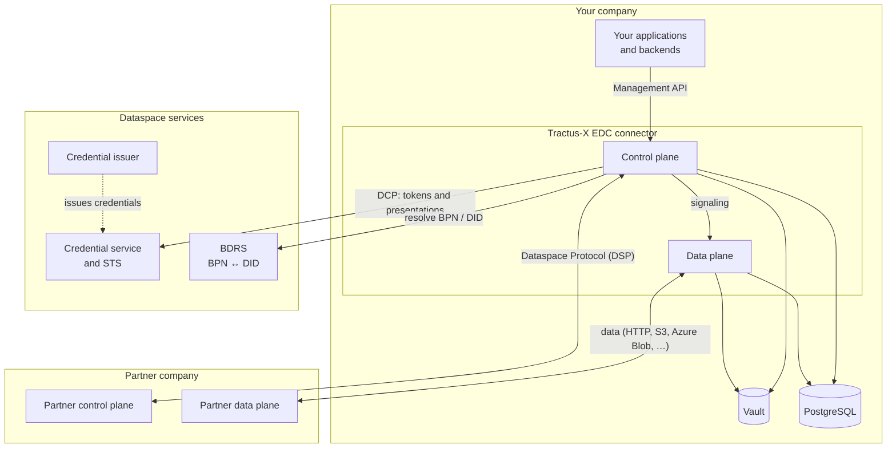
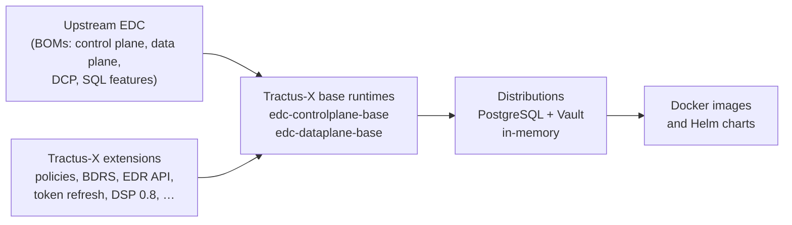

# Architecture overview

This section explains how a Tractus-X EDC connector is built and how it talks to the rest of the dataspace. Read it top
to bottom once; afterwards each page works as a reference.

## System context

Three conversations happen at the same time:

1. **Your applications ↔ your control plane** over the **Management API**: you describe what you offer, or what you
   want to consume.
2. **Your control plane ↔ the partner's control plane** over the **Dataspace Protocol (DSP)**: catalog, contract
   negotiation and transfer process. Every DSP request carries a token, and the receiver checks the sender's
   **verifiable credentials** via the **Decentralized Claims Protocol (DCP)**.
3. **Data plane ↔ data plane** (or partner application ↔ your data plane): the actual data, protected by a short-lived
   token from the transfer.

## Building blocks

| Block | Role | Learn more |
|---|---|---|
| Control plane | Catalog, negotiations, agreements, transfer processes, policies, EDR cache | [Components](components.md) |
| Data plane | Moves or proxies data; issues and refreshes access tokens | [Components](components.md) |
| Identity | DID, wallet/credential service, STS, BDRS, trusted issuers | [Identity and trust](identity-and-trust.md) |
| Policies | ODRL policies with Catena-X constraints, evaluated at catalog, negotiation and transfer time | [Catena-X policies](policies.md) |
| Flows | The step-by-step choreography between the two connectors | [Data exchange flows](flows.md) |
| EDRs | Access tokens for pull transfers, cached and refreshed for you | [EDRs and token refresh](edr-and-token-refresh.md) |
| State | PostgreSQL stores, Flyway migrations, secrets in Vault | [Persistence and state](persistence.md) |

## How Tractus-X EDC relates to upstream EDC

Tractus-X EDC is **not a fork**. It is a set of extensions and runtime distributions on top of the upstream
[Eclipse Dataspace Components](https://github.com/eclipse-edc/Connector):

The upstream version this release builds on is pinned in
[`gradle/libs.versions.toml`](../../gradle/libs.versions.toml) (the `edc` entry). See
[Code architecture](../developer/code-architecture.md) for the module layout.

## Protocols at a glance

| Protocol | Between | Versions in Tractus-X EDC |
|---|---|---|
| [Dataspace Protocol (DSP)](https://eclipse-dataspace-protocol-base.github.io/DataspaceProtocol/) | Control plane ↔ control plane | `2025-1` (default, path `/2025-1`) and the legacy `v0.8` (path `/`, kept for downward compatibility) |
| [Decentralized Claims Protocol (DCP)](https://eclipse-dataspace-dcp.github.io/decentralized-claims-protocol/) | Connector ↔ credential service | v1.0 |
| Data plane signaling | Control plane ↔ data plane | upstream EDC signaling API (`/v1/dataflows`) |
| Management API | Your apps ↔ control plane | `v3` (plus Tractus-X endpoints) |

The consumer chooses the DSP version with the `protocol` field in Management API requests:
`dataspace-protocol-http:2025-1` or the legacy `dataspace-protocol-http`. The
[connector discovery](flows.md#connector-discovery) endpoint tells you which version a partner supports.

## Design decisions

Every significant decision is recorded as an [architecture decision record](../development/decision-records/index.md).
Good starting points:

- [DSP downward compatibility](../development/decision-records/2025-02-12-dsp-downward-compatibility/README.md)
- [Token refresh](../development/decision-records/2024-03-05_token_refresh/README.md)
- [Multi-dataspace support](../development/decision-records/2026-01-07_multi-dataspace-support/README.md)
- [Logging and metrics strategy](../development/decision-records/2025-07-09-logging_and_metrics_strategy/README.md)

## NOTICE

This work is licensed under the [CC-BY-4.0](https://creativecommons.org/licenses/by/4.0/legalcode).

- AI Disclosure: This file was entirely AI-generated. The AI-generated portions are made available under CC0-1.0 and
  not subject to the project's license. The human contributor has reviewed and verified that the content is correct.
- SPDX-License-Identifier: CC-BY-4.0 AND CC0-1.0
- SPDX-FileCopyrightText: 2026 Catena-X Automotive Network e.V.
- SPDX-FileCopyrightText: 2026 Contributors to the Eclipse Foundation
- Assisted-By: GitHub Copilot (claude-opus-5.5)
- Source URL: <https://github.com/eclipse-tractusx/tractusx-edc>
