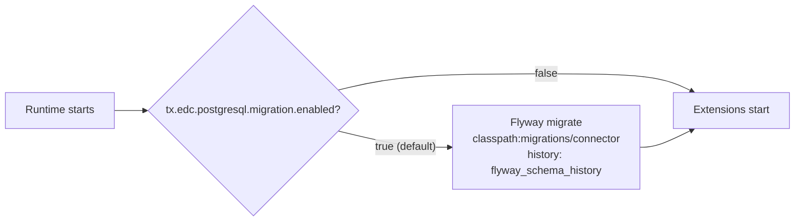

# Persistence and state

A connector keeps two kinds of state: **records** (assets, policies, negotiations, transfers, EDR index, …) in
**PostgreSQL**, and **secrets** (keys, tokens, credentials of data addresses) in **HashiCorp Vault**.

## PostgreSQL

Both production runtimes use PostgreSQL. In the official chart, control plane and data plane share **one database and
schema**.

| Owner | Tables |
|---|---|
| Control plane (upstream) | `edc_asset`, `edc_policydefinitions`, `edc_contract_definitions`, `edc_contract_negotiation`, `edc_contract_agreement`, `edc_transfer_process`, `edc_policy_monitor`, `edc_data_plane_instance`, `edc_edr_entry`, `edc_lease`, `edc_jti_validation` |
| Control plane (Tractus-X) | `edc_business_partner_group`, `edc_agreement_retirement`, `edc_contract_agreement_bpns` |
| Data plane | `edc_data_plane`, `edc_accesstokendata` |

Connection settings:

| Setting | Meaning |
|---|---|
| `edc.datasource.default.url`, `.user`, `.password` | Default data source used by all stores |
| `edc.sql.store.<store>.datasource` | Optional: a different named data source for one store |

### Schema migrations with Flyway

The schema is created and upgraded **automatically at startup** by the `connector-migration` extension, which is part of
both production runtimes.

| Setting | Default | Meaning |
|---|---|---|
| `tx.edc.postgresql.migration.enabled` | `true` | Run migrations at startup |
| `tx.edc.postgresql.migration.schema` | `public` | Target schema |

Things to know:

- The migrations live in
  [`edc-extensions/migrations/connector-migration/src/main/resources/migrations/connector/`](https://github.com/eclipse-tractusx/tractusx-edc/tree/main/edc-extensions/migrations/connector-migration/src/main/resources/migrations/connector).
  Existing databases are baselined at version `1.0.0`.
- The runtime **refuses to start** without `edc.participant.context.id`, because it is used as a value in the migrated
  data. Never change it after the first start.
- Run one migration at a time: when you roll out a new version, let one pod finish its startup before scaling up.
- If you want to run migrations from a pipeline instead, disable them in the runtime and apply the same scripts with
  Flyway yourself.

Adding or reviewing a migration is described in the `sql-migration` skill of the
[Connector Sensei](../development/connector-sensei/README.md).

## Vault

Secrets are never stored in the database. The connector reads and writes them in Vault by **alias**:

| Secret | Referenced by |
|---|---|
| STS / DIV OAuth client secret | `dcp.sts.oauth.client.secret_alias` |
| Private key for signing data plane tokens | `dataplane.token.signer.privatekey_alias` |
| Public key for verifying data plane tokens | `dataplane.token.verifier.publickey_alias` |
| Cached EDRs (tokens) | Written by the consumer control plane |
| Credentials of an asset's backend | `dataAddress` properties that name a secret alias |

The HashiCorp Vault client uses the KV engine at `vault.hashicorp.paths.secret` (default `/v1/secret`), with an optional
`folder` prefix for all keys.

## The in-memory runtime

`edc-runtime-memory` has no database and no Vault: all records and secrets live in the JVM and are lost on restart.
Secrets can be seeded at startup with `tx.edc.vault.secrets` (`key1:secret1;key2:secret2`). Use it only for development
and tests.

## NOTICE

This work is licensed under the [CC-BY-4.0](https://creativecommons.org/licenses/by/4.0/legalcode).

- AI Disclosure: This file was entirely AI-generated. The AI-generated portions are made available under CC0-1.0 and
  not subject to the project's license. The human contributor has reviewed and verified that the content is correct.
- SPDX-License-Identifier: CC-BY-4.0 AND CC0-1.0
- SPDX-FileCopyrightText: 2026 Catena-X Automotive Network e.V.
- SPDX-FileCopyrightText: 2026 Contributors to the Eclipse Foundation
- Assisted-By: GitHub Copilot (claude-opus-5.5)
- Source URL: <https://github.com/eclipse-tractusx/tractusx-edc>
