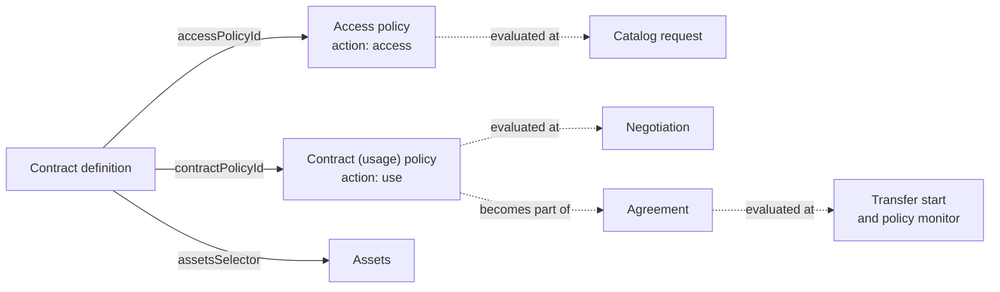

# Catena-X policies

Policies decide **who sees an offer** and **under which conditions data may be used**. EDC policies are
[ODRL](https://www.w3.org/TR/odrl-model/) written in JSON-LD. Tractus-X EDC adds the Catena-X constraints defined in
the standard
[CX-0152 Policy Constraints for Data Exchange](https://catenax-ev.github.io/docs/next/standards/CX-0152-PolicyConstrainsForDataExchange).
These constraints are specific to Catena-X; other dataspaces add their own policy rules as extensions.

## Access policy vs contract policy

A **contract definition** links assets to two policies:



| | Access policy | Contract (usage) policy |
|---|---|---|
| Action | `access` (`cx-policy:access`) | `use` (`odrl:use`) |
| Question it answers | "May this partner **see** the offer?" | "On which **terms** may this partner use the data?" |
| Evaluated | On every catalog request | During negotiation; the agreement's policy again at transfer time |
| Typical constraints | `Membership`, `FrameworkAgreement`, `BusinessPartnerGroup` | `FrameworkAgreement` **and** `UsagePurpose` (both mandatory), plus use-case terms |

The `contract-definition-policies` validator enforces the split: a contract definition's `accessPolicyId` must
reference a policy with action `access`, and its `contractPolicyId` one with action `use`.

!!! important "Every Catena-X usage policy needs two constraints"

    A usage policy must contain at least `FrameworkAgreement` (e.g. `DataExchangeGovernance:1.0`) **and**
    `UsagePurpose`, combined with `and`. Offers without them are not accepted in the Catena-X dataspace.

## An example pair

=== "Access policy"

    Only active Catena-X members who signed the data exchange governance framework see the offer.

    ```json
    {
      "@context": [
        "https://w3id.org/dspace/2025/1/odrl-profile.jsonld",
        "https://w3id.org/catenax/2025/9/policy/context.jsonld",
        { "@vocab": "https://w3id.org/edc/v0.0.1/ns/" }
      ],
      "@type": "PolicyDefinition",
      "@id": "access-members",
      "policy": {
        "@type": "Set",
        "permission": [{
          "action": "access",
          "constraint": [{
            "and": [
              { "leftOperand": "Membership", "operator": "eq", "rightOperand": "active" },
              { "leftOperand": "FrameworkAgreement", "operator": "eq", "rightOperand": "DataExchangeGovernance:1.0" }
            ]
          }]
        }]
      }
    }
    ```

=== "Usage policy"

    Data may be used under the governance framework, for quality notifications only.

    ```json
    {
      "@context": [
        "https://w3id.org/dspace/2025/1/odrl-profile.jsonld",
        "https://w3id.org/catenax/2025/9/policy/context.jsonld",
        { "@vocab": "https://w3id.org/edc/v0.0.1/ns/" }
      ],
      "@type": "PolicyDefinition",
      "@id": "usage-quality",
      "policy": {
        "@type": "Set",
        "permission": [{
          "action": "use",
          "constraint": {
            "and": [
              { "leftOperand": "FrameworkAgreement", "operator": "eq", "rightOperand": "DataExchangeGovernance:1.0" },
              { "leftOperand": "UsagePurpose", "operator": "isAnyOf", "rightOperand": ["cx.core.qualityNotifications:1"] }
            ]
          }
        }]
      }
    }
    ```

The `@context` `https://w3id.org/catenax/2025/9/policy/context.jsonld` lets you write short names such as
`Membership`. They expand to IRIs in the `https://w3id.org/catenax/2025/9/policy/` namespace.

## Validation at creation time

With `controlplane.policy.validation.enabled: true` (the default), `POST /v3/policydefinitions` **rejects** policies
with unknown constraints, wrong operators or forbidden combinations. Each constraint has a JSON schema in
[`edc-extensions/cx-policy/src/main/resources/jsonschema/cx-policy/`](https://github.com/eclipse-tractusx/tractusx-edc/tree/main/edc-extensions/cx-policy/src/main/resources/jsonschema/cx-policy).
For example:

- `BusinessPartnerGroup` and `BusinessPartnerNumber` accept `isAnyOf` / `isNoneOf` with an **array** of values.
- `UsagePurpose` accepts `isAnyOf` with an array of known purposes.
- `Membership` must be `eq "active"`.

!!! warning "Keep validation on"

    The policy engine treats a constraint it has **no function for** as satisfied. A typo in a left operand can
    therefore silently open an offer to everyone. Validation catches this before the policy is stored.

## Which constraint goes where

| Constraint | Action | Rule type |
|---|---|---|
| `Membership`, `FrameworkAgreement` | `access`, `use` | permission (checked against the partner's verifiable credentials) |
| `BusinessPartnerGroup`, `BusinessPartnerNumber` | `access` | permission (checked against the partner's BPN) |
| `UsagePurpose`, `ContractReference`, `ContractTermination`, `ConfidentialInformationMeasures`, `ConfidentialInformationSharing`, `DataFrequency`, `DataUsageEndDate`, `DataUsageEndDefinition`, `DataUsageEndDurationDays`, `ExclusiveUsage`, `JurisdictionLocation`, `JurisdictionLocationReference`, `Liability`, `Precedence`, `VersionChanges`, `Warranty`, `WarrantyDefinition`, `WarrantyDurationMonths` | `use` | permission |
| `AffiliatesBpnl`, `AffiliatesRegion` | `use` | permission or prohibition |
| `UsageRestriction` | `use` | prohibition |
| `DataProvisioningEndDate`, `DataProvisioningEndDurationDays` | `use` | obligation |

Many use-case terms (for example `Warranty`) are **contractual**: the connector checks that they are well-formed and
records them in the agreement, but it cannot enforce them technically. The source of truth is
[`PolicyValidationConstants`](https://github.com/eclipse-tractusx/tractusx-edc/blob/main/edc-extensions/cx-policy/src/main/java/org/eclipse/tractusx/edc/policy/cx/validator/PolicyValidationConstants.java);
the [policy walkthrough](../usage/management-api-walkthrough/02_policies.md#conventions-on-constraints) explains each
constraint.

## Business partner groups

Instead of listing BPNs in every policy, keep **groups** in the connector and reference them:

```json
{ "leftOperand": "BusinessPartnerGroup", "operator": "isAnyOf", "rightOperand": ["gold-customers"] }
```

You manage the BPN → group assignment with the `/v3/business-partner-groups` API. Groups can change at any time
without touching the policy. At catalog time the connector resolves the caller's BPN and looks up its groups. In the
2025-09 namespace, `BusinessPartnerGroup` and `BusinessPartnerNumber` are evaluated **only in the catalog scope**. See
[Tutorial 2](../tutorials/access-control-bpn-groups.md).

## Legacy namespace

Policies written with the old namespace `https://w3id.org/catenax/policy/` are still evaluated by the
`cx-policy-legacy` extension, so existing agreements keep working. New policies should use the 2025-09 context.

## Further reading

- [Policy walkthrough](../usage/management-api-walkthrough/02_policies.md)
- [BPN validation README](../../edc-extensions/bpn-validation/README.md)
- [Catena-X standards](https://catenax-ev.github.io/docs/standards/overview)

## NOTICE

This work is licensed under the [CC-BY-4.0](https://creativecommons.org/licenses/by/4.0/legalcode).

- AI Disclosure: This file was entirely AI-generated. The AI-generated portions are made available under CC0-1.0 and
  not subject to the project's license. The human contributor has reviewed and verified that the content is correct.
- SPDX-License-Identifier: CC-BY-4.0 AND CC0-1.0
- SPDX-FileCopyrightText: 2026 Catena-X Automotive Network e.V.
- SPDX-FileCopyrightText: 2026 Contributors to the Eclipse Foundation
- Assisted-By: GitHub Copilot (claude-opus-5.5)
- Source URL: <https://github.com/eclipse-tractusx/tractusx-edc>
