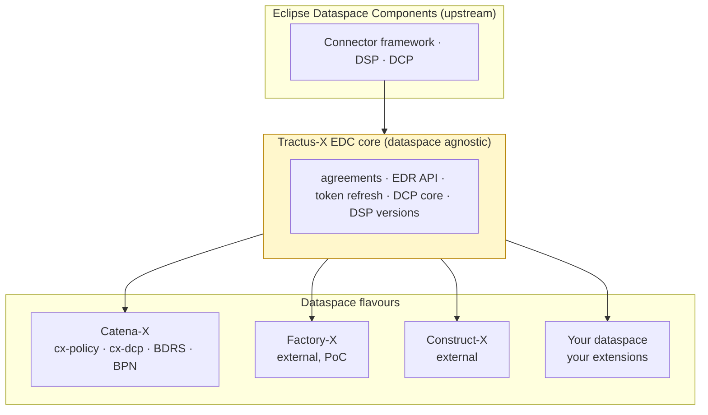

# Supported dataspaces

Tractus-X EDC started as the connector of the [Catena-X](https://catena-x.net/) automotive dataspace. Since then,
more dataspaces have emerged, many of them under the
[Manufacturing-X](https://www.plattform-i40.de/IP/Redaktion/EN/Standardartikel/manufacturing-x.html) umbrella, and
they need the same connector without the Catena-X specific parts. The
[multi-dataspace support ADR](../development/decision-records/2026-01-07_multi-dataspace-support/README.md) (January
2026) therefore turns Tractus-X EDC into a **dataspace-agnostic core with dataspace-specific flavours**, and makes it
the one place where all of them are developed.

## Status per dataspace

| Dataspace | Connector | Status |
|---|---|---|
| [Catena-X](https://catena-x.net/) (automotive) | Tractus-X EDC, this repository | **Supported and released.** Every Tractus-X release, images on Docker Hub, Helm charts. In production. |
| [Factory-X](https://factory-x.org/) (manufacturing, Manufacturing-X) | [Factory-X EDC](https://github.com/factory-x-contributions/factoryx-edc) | Developed externally on Tractus-X EDC as midstream, today by excluding the Catena-X modules. Proof of concept; may be merged here when it reaches production status. |
| [Construct-X](https://construct-x.org/) (construction, Manufacturing-X) | [Construct-X EDC](https://github.com/project-construct-x/constructx-edc) | Developed externally on Tractus-X EDC. |
| Semiconductor-X | none yet | Named in the ADR as a dataspace that needs a connector without Catena-X specifics. |
| Your dataspace | Tractus-X EDC with your extensions | Possible today: write your rules as extensions, see [Create a dataspace extension](create-extension.md). |

Only the **Catena-X flavour** is part of the Tractus-X release for now. Flavours for other dataspaces are built and
released by those dataspaces, and may join the Tractus-X release later (the ADR leaves that open).

## Core and flavours

The ADR sorts every extension into one of three groups:

| Group | Meaning | Examples today |
|---|---|---|
| **Generic** (`core`) | Works in any dataspace | `agreements`, `edr`, `tokenrefresh-handler`, `event-subscriber`, `tx-dcp` |
| **Dataspace specific** | Only for one dataspace; prefixed with it, such as `cx-` for Catena-X | `cx-policy`, `cx-policy-legacy`, `cx-dcp`, `cx-connector-discovery`, `cx-dataspace-protocol`, `bdrs-client`, `bpn-validation`, `agreements-bpns` |
| **Generic, but specific** | A generic need with a Catena-X implementation, to be split into the two groups above | `migrations` (still to do); `dcp`, `connector-discovery` and `dataspace-protocol` are already split |

The runtimes follow later: today the `edc-controlplane-base` and `edc-dataplane-base` runtimes are the Catena-X
flavour. The ADR sketches a future layout with `edc-controlplane-core` and one module per flavour
(`edc-controlplane-catena-x`, `edc-controlplane-factory-x`, …). Existing image, chart and Maven names stay as long as
possible, so the change is silent for Catena-X users.

## Where new work happens

- **Refactoring of existing extensions** (splitting generic from Catena-X code) happens **in this repository**.
- **New flavours and new dataspace extensions** are developed **outside** first, in another repository of Eclipse
  Tractus-X or of the dataspace, open or closed source, and may be merged here once they reach production status.

To start one, read [Create a dataspace extension](create-extension.md) and come to the
[Connector Open Meeting](https://eclipse-tractusx.github.io/community/open-meetings#edc-weekly).

## NOTICE

This work is licensed under the [CC-BY-4.0](https://creativecommons.org/licenses/by/4.0/legalcode).

- AI Disclosure: This file was entirely AI-generated. The AI-generated portions are made available under CC0-1.0 and
  not subject to the project's license. The human contributor has reviewed and verified that the content is correct.
- SPDX-License-Identifier: CC-BY-4.0 AND CC0-1.0
- SPDX-FileCopyrightText: 2026 Catena-X Automotive Network e.V.
- SPDX-FileCopyrightText: 2026 Contributors to the Eclipse Foundation
- Assisted-By: Claude Code (claude-opus-5-5)
- Source URL: <https://github.com/eclipse-tractusx/tractusx-edc>
