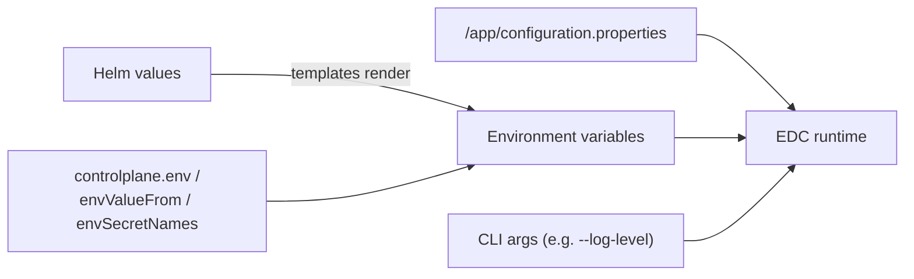

# Configuration

A Tractus-X EDC runtime is configured through **EDC settings**: flat keys such as `edc.participant.id` or
`web.http.management.port`. This page explains where settings come from, how they map to environment variables and Helm
values, and how to pass secrets safely.

## Three ways to set a setting



1. **Environment variables.** The usual way in Kubernetes. The name is the setting key in upper case, with `.` and
   `-` replaced by `_`: `edc.participant.id` → `EDC_PARTICIPANT_ID`.
2. **A properties file.** The image starts Java with `-Dedc.fs.config=/app/configuration.properties`, so a mounted
   file at that path is read.
3. **Command-line arguments.** The chart uses this for the log level (`--log-level=INFO`).

Every setting is declared in code with a `@Setting` annotation, which records its key, description and default. Each
extension's README lists its settings.

## How Helm values become settings

The chart translates the documented values into environment variables. A few examples:

| Helm value | Environment variable | Setting |
|---|---|---|
| `participant.id` | `EDC_PARTICIPANT_ID`, `EDC_IAM_ISSUER_ID` | `edc.participant.id`, `edc.iam.issuer.id` |
| `participant.bpnl` | `TRACTUSX_EDC_PARTICIPANT_BPN` | `tractusx.edc.participant.bpn` |
| `participant.contextId` | `EDC_PARTICIPANT_CONTEXT_ID` | `edc.participant.context.id` |
| `controlplane.endpoints.management.authKey` | `WEB_HTTP_MANAGEMENT_AUTH_KEY` (with `WEB_HTTP_MANAGEMENT_AUTH_TYPE=tokenbased`) | `web.http.management.auth.key` |
| `controlplane.endpoints.management.jwksUrl` | `WEB_HTTP_MANAGEMENT_AUTH_DAC_KEY_URL` (with `…_AUTH_TYPE=delegated`) | `web.http.management.auth.dac.key.url` |
| `controlplane.bdrs.server.url` | `TX_EDC_IAM_DCP_BDRS_SERVER_URL` | `tx.edc.iam.dcp.bdrs.server.url` |
| `dcp.sts.oauth.token_url` | `EDC_IAM_STS_OAUTH_TOKEN_URL` | `edc.iam.sts.oauth.token.url` |
| `dcp.trustedIssuers[i]` | `EDC_IAM_TRUSTED-ISSUER_<i>-ISSUER_ID` | `edc.iam.trusted-issuer.<i>-issuer.id` |
| `controlplane.policy.validation.enabled` | `EDC_POLICY_VALIDATION_ENABLED` | `edc.policy.validation.enabled` |
| `vault.hashicorp.url`, `vault.hashicorp.token` | `EDC_VAULT_HASHICORP_URL`, `EDC_VAULT_HASHICORP_TOKEN` | `edc.vault.hashicorp.url`, `edc.vault.hashicorp.token` |
| `dataplane.endpoints.proxy.authKey` | `TX_EDC_DPF_CONSUMER_PROXY_AUTH_APIKEY` | `tx.edc.dpf.consumer.proxy.auth.apikey` |
| `dataplane.token.refresh.expiry_seconds` | `TX_EDC_DATAPLANE_TOKEN_EXPIRY` | `tx.edc.dataplane.token.expiry` |

The templates are the source of truth:
[`deployment-controlplane.yaml`](../../charts/tractusx-connector/templates/deployment-controlplane.yaml) and
[`deployment-dataplane.yaml`](../../charts/tractusx-connector/templates/deployment-dataplane.yaml).

## Setting anything the chart does not expose

Each plane (`controlplane`, `dataplane`, and `runtime` in the memory chart) accepts:

| Value | Renders as | Use it for |
|---|---|---|
| `env: {NAME: value}` | plain `env` entries | Non-secret settings |
| `envValueFrom: {NAME: {secretKeyRef: …}}` | `env` with `valueFrom` | **Secrets**, one key at a time |
| `envSecretNames: [secret]` | `envFrom.secretRef` | A whole Secret of environment variables |
| `envConfigMapNames: [configmap]` | `envFrom.configMapRef` | A whole ConfigMap of environment variables |
| `volumes`, `volumeMounts` | pod volumes | Files such as certificates or a properties file |
| `initContainers` | init containers | Preparation steps |

Top-level `customCaCerts` adds your own CA certificates to the Java truststore.

## Passing secrets safely

The chart passes some sensitive values as **plain environment values** taken from `values.yaml`:

- the Management API key (`WEB_HTTP_MANAGEMENT_AUTH_KEY`);
- the consumer proxy API key (`TX_EDC_DPF_CONSUMER_PROXY_AUTH_APIKEY`);
- the Vault token (`EDC_VAULT_HASHICORP_TOKEN`);
- the AWS secret access key;
- the database password, when you bring your own database.

For production, keep them out of your values files and override the variables from Kubernetes Secrets. Environment
variables from `envValueFrom` are rendered after the chart's own, and Kubernetes uses the **last** definition of a
duplicated name:

```yaml
controlplane:
  envValueFrom:
    WEB_HTTP_MANAGEMENT_AUTH_KEY:
      secretKeyRef: {name: edc-secrets, key: management-api-key}
    EDC_VAULT_HASHICORP_TOKEN:
      secretKeyRef: {name: edc-secrets, key: vault-token}
    EDC_DATASOURCE_DEFAULT_PASSWORD:
      secretKeyRef: {name: edc-db, key: password}
```

!!! tip "Check the result"

    Run `helm template` with your values and inspect the rendered `env` list before you install. Kubernetes accepts
    duplicated names, uses the last one and prints a warning; some GitOps tools reject duplicates. Note that
    `envSecretNames` and `envConfigMapNames` **cannot** override the chart's variables, because explicit `env` entries
    always win over `envFrom`.

The chart marks these values as `required`, so keep a non-empty placeholder in your values file when you override them
from a Secret.

Everything else that is secret (the STS client secret, token signing keys, data source credentials of assets) lives
in **Vault** and is referenced by an alias.

## Database settings

| Setting | Default | Meaning |
|---|---|---|
| `edc.datasource.default.url`, `.user`, `.password` | – | The default data source used by all stores. |
| `edc.sql.store.<store>.datasource` | `default` | Use a different data source for one store. |
| `tx.edc.postgresql.migration.enabled` | `true` | Run the Flyway schema migrations at startup. |
| `tx.edc.postgresql.migration.schema` | `public` | Schema the migrations run in. |

See [Persistence and state](../architecture/persistence.md) for how migrations work.

## Look up a setting

To find a setting's key, environment variable, Helm value, documentation and history in one go, use the
`setting-lifecycle` skill of the [Connector Sensei](../development/connector-sensei/README.md):

```bash
.claude/skills/setting-lifecycle/scripts/setting-trace.sh tx.edc.iam.dcp.bdrs.server.url
```

## NOTICE

This work is licensed under the [CC-BY-4.0](https://creativecommons.org/licenses/by/4.0/legalcode).

- AI Disclosure: This file was entirely AI-generated. The AI-generated portions are made available under CC0-1.0 and
  not subject to the project's license. The human contributor has reviewed and verified that the content is correct.
- SPDX-License-Identifier: CC-BY-4.0 AND CC0-1.0
- SPDX-FileCopyrightText: 2026 Catena-X Automotive Network e.V.
- SPDX-FileCopyrightText: 2026 Contributors to the Eclipse Foundation
- Assisted-By: GitHub Copilot (claude-opus-5.5)
- Source URL: <https://github.com/eclipse-tractusx/tractusx-edc>
