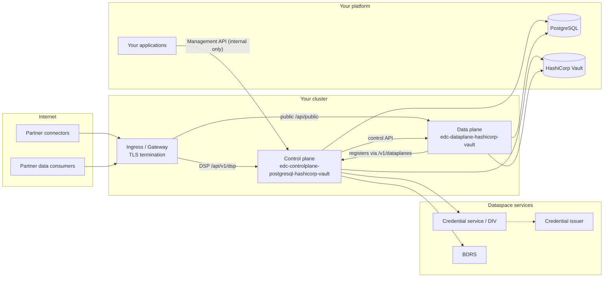

# Deployment overview

This section takes you from "I have nothing" to "my connector runs in production". Start with
[Deploy in five minutes](#deploy-in-five-minutes) below, then plan the real deployment with the rest of this page.

## Deploy in five minutes

Pick the variant that matches what you want to do. All three use the **published** Helm charts and Docker Hub images,
so there is nothing to build. You need [Docker](https://docs.docker.com/get-docker/),
[kind](https://kind.sigs.k8s.io/docs/user/quick-start/#installation) (or any other Kubernetes cluster),
[`kubectl`](https://kubernetes.io/docs/tasks/tools/) and [Helm 3](https://helm.sh/docs/intro/install/).

=== "Try it (in memory)"

    One pod, everything in memory: the fastest way to see the Management API. **For laptops only**, it loses all data
    on restart.

    ```bash
    # 1. A local Kubernetes cluster (skip if you already have one)
    kind create cluster --name tractusx-edc

    # 2. The Tractus-X Helm repository
    helm repo add tractusx-edc https://eclipse-tractusx.github.io/charts/dev
    helm repo update

    # 3. Minimal values: dummy identity settings and a local API key
    cat > edc-try.yaml <<'EOF'
    fullnameOverride: tx-edc
    participant:
      id: "did:web:changeme"
      bpnl: "BPNL000000000001"
      contextId: "try-participant-context"
    dcp:
      sts:
        div:
          url: "https://div.example.org"
        oauth:
          token_url: "https://div.example.org/oauth/token"
          client:
            id: "try-client-id"
            secret_alias: "try-client-secret"
    runtime:
      endpoints:
        management:
          authKey: password
      securityContext:
        readOnlyRootFilesystem: false
      bdrs:
        server:
          url: "https://bdrs.example.org"
      token:
        signer:
          privatekey_alias: "key-1"
        verifier:
          publickey_alias: "key-1"
    EOF

    # 4. Install, then run the chart's own tests
    helm install tx-edc tractusx-edc/tractusx-connector-memory -f edc-try.yaml --wait --timeout 5m
    helm test tx-edc
    ```

    Talk to the Management API:

    ```bash
    kubectl port-forward deployment/tx-edc 8081:8081 &

    curl -s -X POST http://localhost:8081/management/v3/assets/request \
      -H "X-Api-Key: password" -H "Content-Type: application/json" \
      -d '{"@context": {"@vocab": "https://w3id.org/edc/v0.0.1/ns/"}, "@type": "QuerySpec"}'
    ```

    `[]` means the connector is up and you are authenticated. Clean up with `kind delete cluster --name tractusx-edc`.

=== "With PostgreSQL and Vault"

    The **production chart**: a control plane and a data plane, with a PostgreSQL and a **dev-mode** Vault installed
    next to them. Close to a real deployment, still with dummy identity settings.

    ```bash
    kind create cluster --name tractusx-edc
    helm repo add tractusx-edc https://eclipse-tractusx.github.io/charts/dev
    helm repo update

    cat > edc-local.yaml <<'EOF'
    fullnameOverride: tx-edc
    participant:
      id: "did:web:changeme"
      bpnl: "BPNL000000000001"
      contextId: "local-participant-context"
    dcp:
      sts:
        div:
          url: "https://div.example.org"
        oauth:
          token_url: "https://div.example.org/oauth/token"
          client:
            id: "local-client-id"
            secret_alias: "client-secret"
    controlplane:
      endpoints:
        management:
          authKey: password
      bdrs:
        server:
          url: "https://bdrs.example.org"
    dataplane:
      token:
        signer:
          privatekey_alias: "key-1"
        verifier:
          publickey_alias: "key-1"
    # install.postgresql and install.vault default to true: seed the dev Vault
    vault:
      hashicorp:
        url: http://{{ .Release.Name }}-vault:8200
        token: root
      server:
        postStart:
          - sh
          - -c
          - |-
            {
            sleep 5
            /bin/vault kv put secret/client-secret content=kEmH7QRPWhKfy8f+x0pFMw==
            /bin/vault kv put secret/aes-keys content=YWVzX2VuY2tleV90ZXN0Cg==
            }
    EOF

    helm install tx-edc tractusx-edc/tractusx-connector -f edc-local.yaml --wait --timeout 10m
    kubectl rollout status deployment tx-edc-controlplane
    kubectl rollout status deployment tx-edc-dataplane
    helm test tx-edc
    ```

    The Management API is on the control plane:
    `kubectl port-forward deployment/tx-edc-controlplane 8081:8081`, then the same `curl` as in the first tab.

=== "Production"

    A real deployment uses **your** PostgreSQL, Vault, identity (DID, credential service, BDRS) and hostnames. Write
    them into a values file first: [a minimal production values file](helm-chart.md#a-minimal-production-values-file)
    is the starting point, and the [checklist below](#prerequisites-checklist) lists what you need.

    ```bash
    helm repo add tractusx-edc https://eclipse-tractusx.github.io/charts/dev
    helm repo update
    helm search repo tractusx-edc/tractusx-connector -l     # pick a released version

    helm install my-connector tractusx-edc/tractusx-connector \
      --version <chart-version> \
      --namespace edc --create-namespace \
      -f my-values.yaml --wait --timeout 10m

    helm test my-connector --namespace edc
    ```

    Then work through the [production checklist](production-checklist.md) before you let partners in.

!!! info "The first two variants cannot join a dataspace"

    Their DID, credential service and BDRS are placeholders. The connector starts, its APIs answer and the Helm tests
    pass, but it cannot negotiate with a real partner. For a complete local dataspace with two connectors and identity
    services, use the [MXD tutorial](https://github.com/eclipse-tractusx/tutorial-resources/tree/main/mxd). To run the
    charts with images you built yourself, follow the [local quick start](local-quickstart.md), which is the CI
    deployment test.

## What you deploy

Tractus-X EDC ships as **container images** and **Helm charts**. Pick the runtime that matches your goal:

| Image (`tractusx/…` on Docker Hub) | What it is | Use it for |
|---|---|---|
| [`edc-controlplane-postgresql-hashicorp-vault`](https://hub.docker.com/r/tractusx/edc-controlplane-postgresql-hashicorp-vault) | Control plane with PostgreSQL stores and HashiCorp Vault | Production |
| [`edc-dataplane-hashicorp-vault`](https://hub.docker.com/r/tractusx/edc-dataplane-hashicorp-vault) | Data plane with PostgreSQL and HashiCorp Vault | Production |
| [`edc-runtime-memory`](https://hub.docker.com/r/tractusx/edc-runtime-memory) | Control plane and data plane in **one** JVM, in-memory stores and vault | Development and tests only |

| Helm chart | Deploys | Use it for |
|---|---|---|
| [`tractusx-connector`](helm-chart.md) | A control plane and a data plane Deployment, optionally PostgreSQL and Vault as subcharts | Production |
| `tractusx-connector-memory` | One Deployment running `edc-runtime-memory` | Development and tests only |

!!! warning "The in-memory runtime loses everything on restart"

    `edc-runtime-memory` keeps assets, contracts **and secrets** in memory, in plain text. It cannot run more than one
    replica. Never use it for real data.

Images are multi-architecture (`linux/amd64`, `linux/arm64`) and run as a non-root user. Charts are published to the
Tractus-X Helm repository `https://eclipse-tractusx.github.io/charts/dev`.

## The production topology



What this means for you:

- **Two public endpoints.** Only the control plane's **protocol** (DSP) endpoint and the data plane's **public**
  endpoint face the internet.
- **Everything else stays internal.** The Management API, the control API and the metrics port must never be reachable
  from outside.
- **Both planes need PostgreSQL and Vault.** The data plane also has SQL stores and runs the database migrations.
- **Identity comes from outside.** You need a DID, a credential service (the chart is built for a
  decentralized identity verification service, DIV, with an STS) and the Catena-X BDRS. See
  [Identity and trust](../architecture/identity-and-trust.md).

## Prerequisites checklist

Before you install the production chart, have these ready:

- [ ] A Kubernetes cluster and Helm 3.
- [ ] A PostgreSQL database (with a dedicated user) reachable from the cluster.
- [ ] A HashiCorp Vault with a KV secrets engine and a token for the connector.
- [ ] Your **DID** (`participant.id`) and **BPNL** (`participant.bpnl`).
- [ ] A fresh, stable **participant context id** (a UUID). It must never change later.
- [ ] OAuth client credentials for your credential service (STS/DIV) and the client secret stored in Vault.
- [ ] The BDRS URL of your dataspace.
- [ ] A key pair in Vault for signing and verifying data plane tokens.
- [ ] Two hostnames with TLS certificates: one for the control plane protocol endpoint, one for the data plane public
  endpoint.

## Where to go next

<div class="grid cards" markdown>

-   :material-laptop: **[Local quick start](local-quickstart.md)**

    ---

    Run the chart on kind exactly as CI does.

-   :material-tune-variant: **[Helm chart](helm-chart.md)**

    ---

    The values that matter, with defaults and ports.

-   :material-cog-outline: **[Configuration](configuration.md)**

    ---

    How EDC settings, environment variables and Helm values fit together.

-   :material-shield-check-outline: **[Production checklist](production-checklist.md)**

    ---

    Security, availability and operations before go-live.

-   :material-update: **[Upgrades](upgrades.md)**

    ---

    How releases work and how to upgrade safely.

-   :material-school-outline: **[MXD tutorial](https://github.com/eclipse-tractusx/tutorial-resources/tree/main/mxd)**

    ---

    A complete local dataspace (two connectors, identity services) for learning.

</div>

## NOTICE

This work is licensed under the [CC-BY-4.0](https://creativecommons.org/licenses/by/4.0/legalcode).

- AI Disclosure: This file was entirely AI-generated. The AI-generated portions are made available under CC0-1.0 and
  not subject to the project's license. The human contributor has reviewed and verified that the content is correct.
- SPDX-License-Identifier: CC-BY-4.0 AND CC0-1.0
- SPDX-FileCopyrightText: 2026 Catena-X Automotive Network e.V.
- SPDX-FileCopyrightText: 2026 Contributors to the Eclipse Foundation
- Assisted-By: GitHub Copilot (claude-opus-5.5)
- Source URL: <https://github.com/eclipse-tractusx/tractusx-edc>
