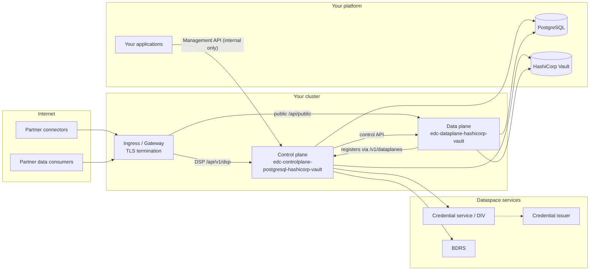

# Deployment overview

This section takes you from "I have nothing" to "my connector runs in production". Start with the
[local quick start](local-quickstart.md), then come back here to plan the real deployment.

## What you deploy

Tractus-X EDC ships as **container images** and **Helm charts**. Pick the runtime that matches your goal:

| Image (`tractusx/…` on Docker Hub) | What it is | Use it for |
|---|---|---|
| [`edc-controlplane-postgresql-hashicorp-vault`](https://hub.docker.com/r/tractusx/edc-controlplane-postgresql-hashicorp-vault) | Control plane with PostgreSQL stores and HashiCorp Vault | Production |
| [`edc-dataplane-hashicorp-vault`](https://hub.docker.com/r/tractusx/edc-dataplane-hashicorp-vault) | Data plane with PostgreSQL and HashiCorp Vault | Production |
| [`edc-runtime-memory`](https://hub.docker.com/r/tractusx/edc-runtime-memory) | Control plane and data plane in **one** JVM, in-memory stores and vault | Development and tests only |

| Helm chart | Deploys | Use it for |
|---|---|---|
| [`tractusx-connector`](helm-chart.md) | A control plane and a data plane Deployment, optionally PostgreSQL and Vault as subcharts | Production |
| `tractusx-connector-memory` | One Deployment running `edc-runtime-memory` | Development and tests only |

!!! warning "The in-memory runtime loses everything on restart"

    `edc-runtime-memory` keeps assets, contracts **and secrets** in memory, in plain text. It cannot run more than one
    replica. Never use it for real data.

Images are multi-architecture (`linux/amd64`, `linux/arm64`) and run as a non-root user. Charts are published to the
Tractus-X Helm repository `https://eclipse-tractusx.github.io/charts/dev`.

## The production topology

What this means for you:

- **Two public endpoints.** Only the control plane's **protocol** (DSP) endpoint and the data plane's **public**
  endpoint face the internet.
- **Everything else stays internal.** The Management API, the control API and the metrics port must never be reachable
  from outside.
- **Both planes need PostgreSQL and Vault.** The data plane also has SQL stores and runs the database migrations.
- **Identity comes from outside.** You need a DID, a credential service (the chart is built for a
  decentralized identity verification service, DIV, with an STS) and the Catena-X BDRS. See
  [Identity and trust](../architecture/identity-and-trust.md).

## Prerequisites checklist

Before you install the production chart, have these ready:

- [ ] A Kubernetes cluster and Helm 3.
- [ ] A PostgreSQL database (with a dedicated user) reachable from the cluster.
- [ ] A HashiCorp Vault with a KV secrets engine and a token for the connector.
- [ ] Your **DID** (`participant.id`) and **BPNL** (`participant.bpnl`).
- [ ] A fresh, stable **participant context id** (a UUID). It must never change later.
- [ ] OAuth client credentials for your credential service (STS/DIV) and the client secret stored in Vault.
- [ ] The BDRS URL of your dataspace.
- [ ] A key pair in Vault for signing and verifying data plane tokens.
- [ ] Two hostnames with TLS certificates: one for the control plane protocol endpoint, one for the data plane public
  endpoint.

## Where to go next

-   :material-laptop: **[Local quick start](local-quickstart.md)**

    ---

    Run the chart on kind exactly as CI does.

-   :material-tune-variant: **[Helm chart](helm-chart.md)**

    ---

    The values that matter, with defaults and ports.

-   :material-cog-outline: **[Configuration](configuration.md)**

    ---

    How EDC settings, environment variables and Helm values fit together.

-   :material-shield-check-outline: **[Production checklist](production-checklist.md)**

    ---

    Security, availability and operations before go-live.

-   :material-update: **[Upgrades](upgrades.md)**

    ---

    How releases work and how to upgrade safely.

-   :material-school-outline: **[MXD tutorial](https://github.com/eclipse-tractusx/tutorial-resources/tree/main/mxd)**

    ---

    A complete local dataspace (two connectors, identity services) for learning.

## NOTICE

This work is licensed under the [CC-BY-4.0](https://creativecommons.org/licenses/by/4.0/legalcode).

- AI Disclosure: This file was entirely AI-generated. The AI-generated portions are made available under CC0-1.0 and
  not subject to the project's license. The human contributor has reviewed and verified that the content is correct.
- SPDX-License-Identifier: CC-BY-4.0 AND CC0-1.0
- SPDX-FileCopyrightText: 2026 Catena-X Automotive Network e.V.
- SPDX-FileCopyrightText: 2026 Contributors to the Eclipse Foundation
- Assisted-By: GitHub Copilot (claude-opus-5.5)
- Source URL: <https://github.com/eclipse-tractusx/tractusx-edc>
