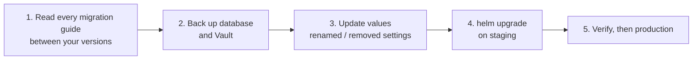

# Upgrades and releases

## How Tractus-X EDC is released

| | |
|---|---|
| **Cadence** | Quarterly, aligned with Tractus-X releases |
| **Version scheme** | Minor version per release (`0.12.0`, `0.13.0`, …). Breaking changes are possible between minor versions. Bugfix releases (`0.13.1`) contain only fixes. |
| **Support** | Only the **latest** release is maintained, and only for critical functional or security issues. Fixes are not backported. |
| **Pre-releases** | Release candidates `X.Y.Z-rcN`; dated snapshots `X.Y.Z-YYYYMMDD-SNAPSHOT` |
| **Release notes** | [GitHub Releases](https://github.com/eclipse-tractusx/tractusx-edc/releases) |
| **Artifacts** | Docker images on Docker Hub (`tractusx/…`), Helm charts at `https://eclipse-tractusx.github.io/charts/dev`, Maven artifacts on Maven Central |

The decisions behind this are recorded in the ADRs
[release train](../development/decision-records/2024-04-11_txedc_release_train/README.md),
[improvements to the versioning scheme](../development/decision-records/2024-07-18-Improvements-versioning-scheme/README.md)
and [release process](../development/decision-records/2025-05-26-release-process/README.md).

## Upgrade in five steps



1. **Read the migration guides.** Do not skip versions when you read them: each guide describes only the step from the
   previous minor version. They are listed in the [migration guides](../migration/index.md) section.
2. **Back up** the PostgreSQL database and the Vault secrets.
3. **Update your values.** Migration guides list renamed Helm values and settings. An unknown setting is silently
   ignored, so check carefully.
4. **Upgrade.**

    ```bash
    helm repo update tractusx
    helm upgrade <release> tractusx/tractusx-connector --version <new-version> -f my-values.yaml
    ```

    The database schema is migrated **automatically** at startup by Flyway (see [Persistence](../architecture/persistence.md)).
5. **Verify** with `helm test <release>` and a catalog request to a known partner.

CI checks on every change that an in-place `helm upgrade` from the latest released chart to the current chart works
(`.github/workflows/upgradeability-test.yaml`).

## Highlights of recent releases

??? note "0.12 → 0.13"

    - `participant.id` now holds your **DID**. The BPNL moved to `participant.bpnl`.
    - `iatp.*` values were renamed to `dcp.*`, and DIM to **DIV** (Decentralized Identity Verifier).
    - The Federated Catalog was removed.
    - The bundled PostgreSQL moved from Bitnami to **CloudPirates** charts and PostgreSQL 18. This cannot be upgraded
      in place; follow the
      [generic PostgreSQL migration guide](https://github.com/eclipse-tractusx/tutorial-resources/blob/main/migration-guides/GENERIC_POSTGRESQL_MIGRATION_GUIDE.md).
    - Per-store data source names now use `edc.sql.store.<store>.datasource`.

    Full guide: [0.12.x → 0.13.x](../migration/2026_06-Version_0.12.x_0.13.x.md)

??? note "0.11 → 0.12"

    Full guide: [0.11.x → 0.12.x](../migration/2026_03-Version_0.11.x_0.12.x.md)

## Upgrading the upstream EDC (for maintainers)

Tractus-X EDC pins one upstream Eclipse EDC version in `gradle/libs.versions.toml`. Bumping it is described in the
`upstream-edc-bump` skill of the [Connector Sensei](../development/connector-sensei/README.md).

## NOTICE

This work is licensed under the [CC-BY-4.0](https://creativecommons.org/licenses/by/4.0/legalcode).

- AI Disclosure: This file was entirely AI-generated. The AI-generated portions are made available under CC0-1.0 and
  not subject to the project's license. The human contributor has reviewed and verified that the content is correct.
- SPDX-License-Identifier: CC-BY-4.0 AND CC0-1.0
- SPDX-FileCopyrightText: 2026 Catena-X Automotive Network e.V.
- SPDX-FileCopyrightText: 2026 Contributors to the Eclipse Foundation
- Assisted-By: GitHub Copilot (claude-opus-5.5)
- Source URL: <https://github.com/eclipse-tractusx/tractusx-edc>
