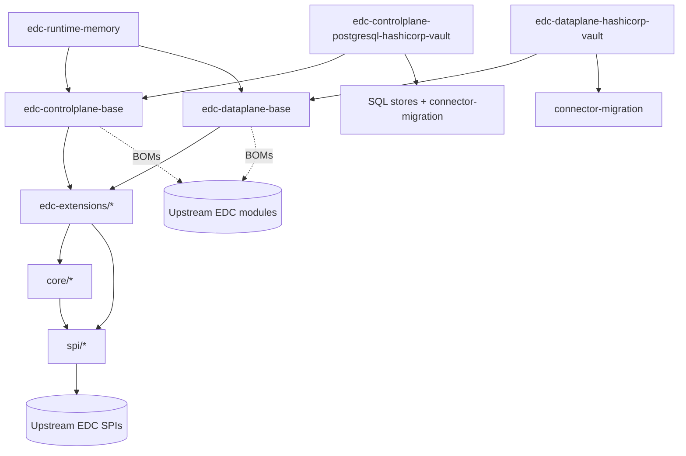
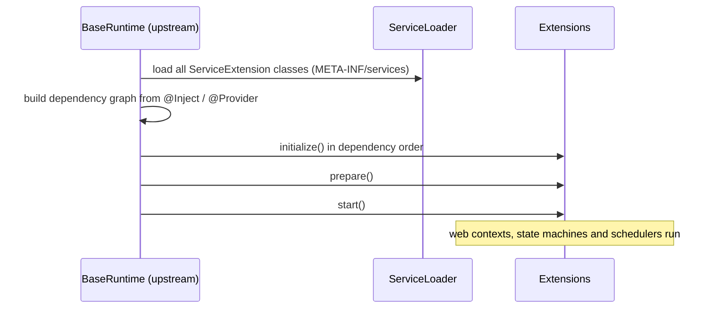

# Code architecture

Tractus-X EDC is a **distribution** of [Eclipse EDC](https://github.com/eclipse-edc/Connector). Most of the connector
comes from upstream EDC modules; this repository adds Tractus-X and Catena-X extensions and assembles them into
runnable runtimes.

## Repository layout

| Path | What lives there |
|---|---|
| `spi/` | Tractus-X service provider interfaces: `core-spi`, `edr-spi`, `bdrs-client-spi`, `dcp-spi`, `tokenrefresh-spi`, … |
| `core/` | Shared libraries: `edr-core`, `json-ld-core`, `json-ld-cx`, `core-utils` |
| `edc-extensions/` | All Tractus-X extensions (policies, BPN validation, EDR API, DCP, DSP 0.8, data plane proxy, migrations, …) |
| `edc-controlplane/` | Control plane runtimes: `edc-controlplane-base`, `edc-controlplane-postgresql-hashicorp-vault`, `edc-runtime-memory` |
| `edc-dataplane/` | Data plane runtimes: `edc-dataplane-base`, `edc-dataplane-hashicorp-vault` |
| `edc-tests/` | End-to-end suites, fixtures, compatibility tests, test runtimes, deployment test values |
| `charts/` | Helm charts `tractusx-connector` and `tractusx-connector-memory` |
| `docs/` | This documentation, the Management API walkthrough, ADRs and migration guides |
| `resources/` | Checkstyle, license headers, IDE code style, the runtime `Dockerfile`, docs tooling |
| `gradle/libs.versions.toml` | Version catalog, including the pinned upstream `edc` version |
| `.claude/`, `.github/agents/` | The [Connector Sensei](../development/connector-sensei/README.md) agent and its skills |

## Layering

- **SPIs** contain interfaces and model classes only. They depend on other SPIs and libraries.
- **Core** libraries implement shared logic on top of SPIs.
- **Extensions** depend on SPIs and core libraries, never on each other's implementation classes. They find each other
  at runtime through dependency injection.
- **Base runtimes** (`edc-controlplane-base`, `edc-dataplane-base`) are plain dependency lists: upstream BOMs plus the
  Tractus-X extensions, minus a few upstream modules that Tractus-X replaces.
- **Distributions** add persistence (SQL stores, Flyway) and secrets (HashiCorp Vault), and build a fat jar and a
  Docker image.

## How a runtime is composed

There is no "main application code". A runtime is **its classpath**:

Consequences you will meet as a developer:

- To ship a feature, add its module to a **base runtime's** `build.gradle.kts`.
- To replace an upstream module, **exclude** it in the base runtime and provide your own. For example,
  `edc-controlplane-base` excludes upstream `edr-cache-api` (replaced by `edr-api-v2`) and the remote STS client
  (replaced by `tx-dcp-sts-div`).
- Default implementations use `@Provider(isDefault = true)`. A SQL store on the classpath replaces the in-memory default
  automatically.

## What each runtime contains

=== "Control plane"

    `edc-controlplane-base` = upstream control plane base + DCP BOMs, plus:

    | Area | Tractus-X modules |
    |---|---|
    | Policies | `cx-policy`, `cx-policy-legacy`, `bpn-validation`, `validators/*` |
    | Identity | `dcp/{cx-dcp, tx-dcp, tx-dcp-sts-div, verifiable-presentation-cache}`, `bdrs-client`, `did-document/*` |
    | Protocol | `dataspace-protocol`, `dsp/*-08` (DSP 0.8 backport), `token-interceptor` |
    | EDR | `edr/{edr-api-v2, edr-callback}`, `tokenrefresh-handler`, `core:edr-core` |
    | Agreements | `agreements`, `agreements-bpns` |
    | Discovery | `connector-discovery/*` |
    | Misc | `log4j2-monitor`, `event-subscriber`, `data-flow-properties-provider` |

    The PostgreSQL distribution adds the SQL stores `retirement-evaluation-store-sql`, `bpns-evaluation-store-sql`,
    `business-partner-store-sql`, `edr-index-lock-sql` and `migrations:connector-migration`.

=== "Data plane"

    `edc-dataplane-base` = upstream data plane base BOM, plus:

    | Area | Tractus-X modules |
    |---|---|
    | Proxy | `dataplane-proxy/{dataplane-proxy-http, dataplane-public-api-v2, edc-dataplane-proxy-consumer-api}` |
    | Token refresh | `dataplane-token-refresh/{token-refresh-api, token-refresh-core}`, `tokenrefresh-handler` |
    | Data flows | `dataflow/{dataflow-api, dataflow-service}`, `non-finite-provider-push-core` |
    | Identity | `dcp:tx-dcp-sts-div` |

    Upstream modules add S3 and Azure Blob transfers, DID resolution and the EDR store.

=== "In-memory"

    `edc-runtime-memory` = `edc-controlplane-base` + `edc-dataplane-base` in **one** process, with in-memory stores and
    a vault seeded from `tx.edc.vault.secrets`. For development and tests only.

## Where to look for…

| I want to understand… | Start here |
|---|---|
| A Catena-X policy constraint | `edc-extensions/cx-policy/src/main/java/org/eclipse/tractusx/edc/policy/cx/` |
| Credential scopes and VP handling | `edc-extensions/dcp/` |
| The EDR API | `edc-extensions/edr/edr-api-v2/` |
| Token refresh on the provider | `edc-extensions/dataplane/dataplane-token-refresh/` |
| A database table | `edc-extensions/migrations/connector-migration/src/main/resources/migrations/connector/` |
| A setting | `grep -rn '"<key>"' --include=*.java .` or the `setting-lifecycle` skill |
| Upstream behaviour | the `edc-upstream-sources` skill, at the pinned version |

The full module list is in the [extension catalogue](../reference/extensions.md).

## NOTICE

This work is licensed under the [CC-BY-4.0](https://creativecommons.org/licenses/by/4.0/legalcode).

- AI Disclosure: This file was entirely AI-generated. The AI-generated portions are made available under CC0-1.0 and
  not subject to the project's license. The human contributor has reviewed and verified that the content is correct.
- SPDX-License-Identifier: CC-BY-4.0 AND CC0-1.0
- SPDX-FileCopyrightText: 2026 Catena-X Automotive Network e.V.
- SPDX-FileCopyrightText: 2026 Contributors to the Eclipse Foundation
- Assisted-By: GitHub Copilot (claude-opus-5.5)
- Source URL: <https://github.com/eclipse-tractusx/tractusx-edc>
