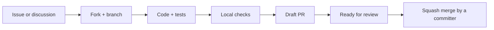

# Contributing

Tractus-X EDC is an [Eclipse Foundation](https://www.eclipse.org/) project. Contributions are welcome from everyone
who follows a few rules.

## Before your first contribution

1. **Sign the [Eclipse Contributor Agreement](https://www.eclipse.org/legal/ECA.php)** with the e-mail address you use
   for your commits. Without an ECA, a pull request cannot be merged.
2. **Talk first.** Open an [issue](https://github.com/eclipse-tractusx/tractusx-edc/issues) or a
   [discussion](https://github.com/eclipse-tractusx/tractusx-edc/discussions) describing what you want to change.
   Unannounced pull requests may be ignored.
3. Read the [PR etiquette](../../pr_etiquette.md), the [style guide](../../styleguide.md) and the
   [coding principles](../development/coding-principles.md).

## The workflow



- Work in your fork and open the pull request against `main`.
- Keep pull requests **focused** on one feature or bug.
- The **PR title** is the commit message after the squash merge, and must follow
  [Conventional Commits](https://www.conventionalcommits.org/en/v1.0.0/): `<type>(<optional scope>): <description>`,
  under 80 characters, with type `build`, `chore`, `ci`, `docs`, `feat`, `fix`, `perf`, `refactor`, `revert`,
  `style` or `test`. Example: `feat(edr): add filter by provider to /v3/edrs/request`.
- Fill in the [pull request template](https://github.com/eclipse-tractusx/tractusx-edc/blob/main/.github/PULL_REQUEST_TEMPLATE.md).
- Mark the PR *Ready for review* only when you are done; reviewers aim to respond within two business days.

## Local checks before you push

```bash
./gradlew checkstyleMain checkstyleTest checkstyleTestFixtures   # Checkstyle errors fail CI
./gradlew test                                                   # unit tests
./gradlew -p edc-tests/e2e/<suite> test -DincludeTags="EndToEndTest"   # if behaviour changed
```

| If you change… | Also do |
|---|---|
| A setting or Helm value | Update the extension README, `values.yaml`, regenerate the chart README with `helm-docs`, and mention it in the migration guide |
| The database schema | Add a Flyway migration in `edc-extensions/migrations/connector-migration` |
| An API | Update the OpenAPI annotations and the [Management API walkthrough](../usage/README.md) |
| A third-party dependency | Run the Eclipse Dash license check (`dependencies-and-dash` skill) and mention the library in the PR |
| Anything operators see | Add an entry to the upcoming [migration guide](../migration/index.md) |

The `breaking-change-guard` skill finds most of these follow-ups for you:

```bash
.claude/skills/breaking-change-guard/scripts/bc-scan.sh
```

## Licenses and headers

- Code is Apache-2.0, documentation CC-BY-4.0.
- Every source file starts with the license header from `resources/java.header` or `resources/hashtag.header`.
  Checkstyle checks it.
- **AI-assisted contributions** carry an AI disclosure and an `Assisted-By:` line, and must be reviewed and verified by
  the person who submits them. See the [Connector Sensei](../development/connector-sensei/README.md) for the exact
  format.

## Documentation

This site is built with [MkDocs Material](https://squidfunk.github.io/mkdocs-material/) from the `docs/` folder and
`mkdocs.yml`. Preview it locally:

```bash
python3 -m venv .venv && . .venv/bin/activate
pip install -r resources/docs/requirements.txt
mkdocs serve        # http://127.0.0.1:8000/tractusx-edc/
```

Before you push, run `mkdocs build --strict`. CI runs it too. For a pull request from a branch of this repository
that changes the documentation, it also publishes a preview at
`https://eclipse-tractusx.github.io/tractusx-edc/pr-preview/<number>/`, links it in a comment on the pull request and
removes it when the pull request is closed. Pull requests from forks are only built; download the site from the
`documentation-site` artifact of the run. New pages must be added to `nav` in `mkdocs.yml` and end
with the `## NOTICE` section.

## Decision records {#decision-records}

Significant technical decisions are recorded as **architecture decision records (ADRs)** in
`docs/development/decision-records/<yyyy-mm-dd>-<title>/README.md`, with the sections *Decision*, *Rationale* and
*Approach*. Propose an ADR in its own pull request **before** you implement a larger change. The `migration-guide-and-adr`
skill creates one in the house format.

All accepted decisions are listed in the [decision record index](../development/decision-records/index.md).

## NOTICE

This work is licensed under the [CC-BY-4.0](https://creativecommons.org/licenses/by/4.0/legalcode).

- AI Disclosure: This file was entirely AI-generated. The AI-generated portions are made available under CC0-1.0 and
  not subject to the project's license. The human contributor has reviewed and verified that the content is correct.
- SPDX-License-Identifier: CC-BY-4.0 AND CC0-1.0
- SPDX-FileCopyrightText: 2026 Catena-X Automotive Network e.V.
- SPDX-FileCopyrightText: 2026 Contributors to the Eclipse Foundation
- Assisted-By: GitHub Copilot (claude-opus-5.5)
- Source URL: <https://github.com/eclipse-tractusx/tractusx-edc>
