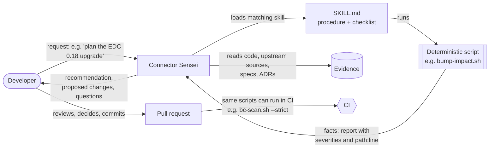

# How the Connector Sensei skills work

The Sensei's skills split each development task into two parts:

1. **Deterministic scripts collect the facts.** They answer "what is true in this repository and in upstream EDC right
   now?": which upstream types changed between two versions, where a setting lives, which migrations are released, which
   endpoints exist, which dependencies are restricted. The same input always produces the same output. They can be read,
   reviewed, run by anyone, and run in CI.
2. **The Sensei turns the facts into recommendations.** It reads the script output together with the code, the specs
   and the project's decision records. Then it explains what the facts mean, recommends what to do, proposes concrete
   changes (code, config, migration, docs), and asks for the decisions only a human can make.

**The human decides and reviews.** Nothing is pushed or published without you.

<!-- TOC -->
- [Why split it this way](#why-split-it-this-way)
- [The flow](#the-flow)
- [Anatomy of a skill](#anatomy-of-a-skill)
- [Design principles for the scripts](#design-principles-for-the-scripts)
- [Worked examples](#worked-examples)
- [Catalog](#catalog)
- [Writing a new skill](#writing-a-new-skill)
- [Limits](#limits)
<!-- TOC -->

## Why split it this way

| | Deterministic script | Sensei (AI agent) |
|---|---|---|
| Good at | Exhaustive, repeatable fact-finding: diffs, inventories, cross-references, version comparisons | Interpretation, prioritisation, explaining *why*, adapting a pattern to a new case, writing prose and code |
| Weak at | Judgement, context, "is this acceptable?" | Remembering facts precisely: upstream EDC renames things often (IATP→DCP, DIM→DIV, `v4alpha`→`v3`, DSP 0.8→2025-1), and memory goes stale |
| Output | Reports with severities and `path:line` | Recommendations, patches, documents, questions |
| Trust model | Inspect the script once, then trust its output | Check its evidence, review its proposal |

Scripts alone tell you *that* `ContractAgreement` changed upstream, but not what to do about it. An agent alone guesses
from memory, and is often wrong about a fast-moving codebase. Together, the agent's reasoning starts from complete and
current facts, and every recommendation can be traced back to them.

## The flow



1. You describe the goal in your own words.
2. The Sensei matches it to a skill from the skill's `description` and loads its `SKILL.md`.
3. It runs the skill's script(s) and reads the report.
4. It verifies and deepens the facts by opening the code the report points to, the upstream sources at the pinned
   version (`edc-upstream-sources`), the specs and the decision records.
5. It answers with a recommendation and the concrete next step. When you ask, it implements the change, again
   following the skill's checklist.
6. You review. The same deterministic checks can guard the PR in CI.

## Anatomy of a skill

```text
.claude/skills/<skill-name>/
├── SKILL.md          # front matter (name, description) + procedure, conventions, checklist, pitfalls
└── scripts/
    └── <tool>.sh     # deterministic helper(s): read-only unless they explicitly scaffold new files
```

- **`description`** (front matter) decides *when* the skill is used. It names the task and the trigger phrases
  ("upgrade EDC", "rename a setting", "is this breaking?").
- **The `SKILL.md` body** is the procedure the Sensei follows: where the truth lives in this repo, the house conventions
  (naming, versioning, deprecation, docs format), a checklist, and how to debug typical failures.
- **The scripts** are the deterministic part. The procedure says when to run them and how to read their output.

Claude Code and GitHub Copilot both load skills from `.claude/skills/`. One copy serves both tools.

## Design principles for the scripts

1. **Evidence, version-pinned.** Upstream facts come from the exact EDC version in `gradle/libs.versions.toml`, read from
   sources jars (Gradle cache or Maven Central). Local clones and memory are never the source.
2. **Read-only by default.** Scripts never modify existing repository files. Scaffolding commands only create new files
   and print the remaining manual steps.
3. **Reproduce CI where CI exists.** `dash-check.sh` builds the dependency list with the same Gradle tasks as
   `.github/actions/generate-and-check-dependencies`. `e2e.sh run` uses the CI test tags. `bc-scan.sh` checks what the
   helm-docs and Checkstyle jobs would reject.
4. **Honest heuristics.** Where a script guesses (e.g. "this looks like a removed setting"), it says so and grades the
   finding (BLOCKER, BREAKING, HIGH, WARN). The Sensei is told to confirm each finding.
5. **Output for humans and agents.** Plain text tables, one finding per line, `path:line`, severities, and links to the
   next step.
6. **Portable.** bash 3.2+ (stock macOS) and Linux, standard tools only, no new build dependencies.
7. **Tested against real history.** Each script was validated on past changes of this repository, for example:
   - `bump-impact.sh 0.16.0 0.17.0` finds the `claims` columns that became `V1_9_0__Add_ClaimsColumn.sql`, and the newly
     deprecated `EndpointDataReferenceEntry`.
   - `bc-scan.sh` reproduces the breaking changes of the IATP→DCP rename (#2684) and the participant-id change (#2742).
   - `dash-check.sh` reproduces CI's result: 464 coordinates, 456 approved, 8 restricted.

## Worked examples

### Adopting upstream changes (EDC version bump)

> "Plan the upgrade from EDC 0.17.0 to 0.18.0."

1. **Facts.** `bump-impact.sh 0.17.0 0.18.0` lists the upstream types Tractus-X imports that were removed, moved or
   changed (ranked by how many Tractus-X files use them), upstream settings removed or added, and SQL schema deltas.
2. **Recommendation.** The Sensei reads the diffs (`edc-src.sh diff <Type> 0.17.0 0.18.0`) for the high-impact types
   and the release notes. It groups the work: compile fixes, behaviour changes in overridden areas (DSP 0.8 backports,
   DCP, policy), new Flyway migrations for each schema delta, settings for the migration guide.
3. **Proposal.** On request it applies the bump, fixes compile errors type by type, creates migrations with
   `migrations.sh new connector …`, and drafts the migration-guide section.
4. **Guard.** `bc-scan.sh` and the test suites confirm nothing else broke.

### Adopting an upstream method or deprecation

> "Upstream deprecated `EndpointDataReferenceEntry`. What should we do?"

1. **Facts.** `edc-src.sh diff EndpointDataReferenceEntry 0.16.0 0.17.0` shows `@Deprecated(since =
   "management-api:v3")`. `bump-impact.sh` shows that 7 Tractus-X main-code files (14 including tests) import it.
2. **Recommendation.** The Sensei looks up the replacement upstream (`edc-src.sh grep`), compares it with how
   Tractus-X uses the type (EDR API, EDR callback, token refresh), and proposes a migration path. That includes whether
   the Tractus-X `/v3/edrs` API contract changes for clients.
3. **Decision for you.** Adopt now or in the next minor, and whether a deprecation period for clients is needed.

### Updating documentation for a release

> "Draft the 0.13 → 0.14 migration guide."

1. **Facts.** `draft-migration-guide.sh --branch HEAD` collects the breaking-change scan against `0.13.0`, the
   upstream version change, new migrations, and user-facing commits since the release. On the current branch it surfaced
   the removed Helm value `postgresql.persistence.storageClass`.
2. **Recommendation.** The Sensei turns each relevant item into a numbered section in the house style, fills
   old→new tables with `setting-trace.sh`, and lists what it dropped and why.
3. **Decision for you.** Which items operators really need, and the wording.

### Reviewing a pull request

> "Review PR #1234."

1. **Facts.** `bc-scan.sh <base>` reports released migrations edited, removed settings, Helm values, env vars and API
   paths, protocol-surface changes, and missing follow-ups.
2. **Recommendation.** The Sensei confirms each finding in the diff and adds what the scanner cannot see (JSON-LD shape
   changes, semantics, security). It proposes fixes, such as deprecating instead of removing, or adding a migration
   instead of editing one.
3. **Decision for you.** Approve, request changes, or post comments (it drafts them; you post).

## Catalog

See [`.claude/skills/README.md`](../../../.claude/skills/README.md) for every implemented skill with its script, and for the
planned skills (`cx-policy-constraint`, `connector-log-triage`, `multi-dataspace-split`), which are documented as
designs only.

| Skill | Deterministic part (facts) | Sensei's part (judgement) |
|---|---|---|
| `edc-upstream-sources` | Upstream class, schema or setting at an exact version; diffs between versions | What the upstream behaviour means for Tractus-X |
| `upstream-edc-bump` | Removed, moved and changed types; settings and schema deltas | Upgrade plan, fixes, backports, migrations |
| `setting-lifecycle` | Every place a setting lives (code, env, Helm, docs, guides, tests) | Rename and deprecation strategy, chart and doc changes |
| `breaking-change-guard` | Graded findings for a change set | Confirm, add what is missing, propose fixes |
| `new-extension` | A module scaffold that builds green | Placement (generic vs `cx-`), design, wiring |
| `sql-migration` | Folder status, next version, new file | DDL/DML, idempotency, rollout |
| `e2e-test-author` | Suite map, test scaffold, CI-equivalent run | Scenario design, fixtures, de-flaking |
| `management-api-endpoint` | Endpoint inventory (context, tests, docs, deprecation) | API design, versioning, validation, docs |
| `migration-guide-and-adr` | Evidence since the last release; ADR skeleton | The guide and decision text |
| `dependencies-and-dash` | CI-equivalent dependency list, Dash result, diff vs published | Alternatives, pinning, IP review path |

## Writing a new skill

1. **Pick a recurring task** with a clear fact-finding part. Look at what PRs and reviews repeatedly need (`git log`,
   review comments).
2. **Write the script first.**
   - Deterministic and read-only, or explicit scaffolding.
   - `--help` text in the header comment.
   - `set -euo pipefail`, and avoid `grep -q` in pipelines (SIGPIPE under `pipefail` yields false negatives).
   - bash 3.2 compatible.
   - The license header with the AI disclosure block, if AI-assisted.
3. **Validate it on real history.** Run it against past commits or releases where you know the right answer, and keep
   the results for the PR description.
4. **Write `SKILL.md`.** A precise `description` with trigger phrases, then where the truth lives, the procedure, the
   house conventions, a checklist and the debugging tips. Keep it under about 200 lines and link, rather than copy,
   long docs.
5. **Register it.** Add it to `.claude/skills/README.md`, the skill table in both agent files, and
   `.github/copilot-instructions.md`.
6. **Consider CI.** If the script's output is a pass/fail gate, it can also run in a workflow (for example
   `bc-scan.sh --strict` on PRs). That is a separate decision for the maintainers.

## Limits

- Scripts are heuristics where they say so. A clean `bc-scan.sh` does not prove a change is compatible; the Sensei's
  review and the compatibility and TCK tests do the rest.
- Some checks need Docker (E2E, Postgres) or network access (upstream sources, Eclipse Dash).
- The Sensei proposes. Contributors remain responsible for what they submit, including the AI disclosure and the review
  it attests to.

## NOTICE

This work is licensed under the [CC-BY-4.0](https://creativecommons.org/licenses/by/4.0/legalcode).

- AI Disclosure: This file was entirely AI-generated. The AI-generated portions are made available under CC0-1.0 and
  not subject to the project's license. The human contributor has reviewed and verified that the content is correct.
- SPDX-License-Identifier: CC-BY-4.0 AND CC0-1.0
- SPDX-FileCopyrightText: 2026 Catena-X Automotive Network e.V.
- SPDX-FileCopyrightText: 2026 Contributors to the Eclipse Foundation
- Assisted-By: Claude Code (claude-opus-5-5)
- Source URL: <https://github.com/eclipse-tractusx/tractusx-edc>
