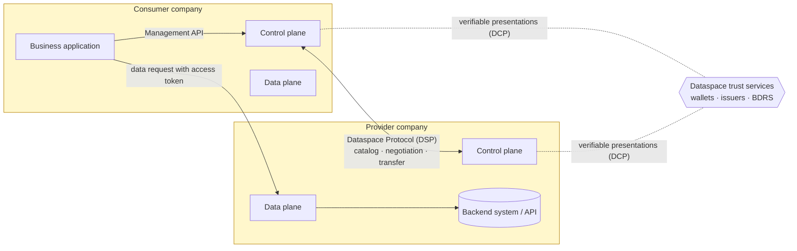

# Tractus-X EDC

The open-source **dataspace connector for Catena-X**. Tractus-X EDC packages the
[Eclipse Dataspace Components (EDC)](https://github.com/eclipse-edc/Connector) with the extensions, policies and
identity integration a company needs to share data **sovereignly** in the Catena-X automotive dataspace, and in any
other dataspace that speaks the Dataspace Protocol.

[Get started :material-rocket-launch-outline:](home/overview.md){ .md-button .md-button--primary }
[Deploy a connector :material-kubernetes:](deployment/index.md){ .md-button }
[Read the code :fontawesome-brands-github:](https://github.com/eclipse-tractusx/tractusx-edc){ .md-button }

## Choose your path

-   :material-lightbulb-on-outline: **New to dataspaces?**

    ---

    Learn what a connector does, why there are two planes, and how contracts, policies and credentials fit
    together, in plain words.

    [:octicons-arrow-right-24: What is Tractus-X EDC?](home/overview.md)

-   :material-sitemap-outline: **Architect**

    ---

    See the components, the trust model (DCP, DIDs, BDRS), the Catena-X policy model and every data exchange flow
    as diagrams.

    [:octicons-arrow-right-24: Architecture](architecture/index.md)

-   :material-kubernetes: **Operator**

    ---

    Install the Helm chart, configure identity, database and vault, harden for production, and upgrade safely.

    [:octicons-arrow-right-24: Deployment](deployment/index.md)

-   :material-school-outline: **Integrator**

    ---

    Offer your first asset, negotiate a contract and fetch data, step by step with copy-paste requests.

    [:octicons-arrow-right-24: Tutorials](tutorials/index.md)

-   :material-code-braces: **Developer**

    ---

    Build the code, understand the module layout and the extension model, write tests, and contribute.

    [:octicons-arrow-right-24: Developers](developer/index.md)

-   :material-api: **API user**

    ---

    Browse the Management API and data plane API, the Tractus-X specific endpoints and the JSON-LD vocabulary.

    [:octicons-arrow-right-24: Reference](reference/index.md)

## The connector in one picture

The **control plane** negotiates *whether* data may flow: it publishes offers, checks policies against verifiable
credentials and records contracts. The **data plane** moves the data once a contract exists. Neither company hands
its data to a central platform. [Learn more :octicons-arrow-right-24:](home/overview.md)

## Popular pages

| I want to… | Go to |
|---|---|
| Run two connectors on my laptop | [Local quick start](deployment/local-quickstart.md) |
| Exchange data for the first time | [Tutorial 1: your first data exchange](tutorials/first-data-exchange.md) |
| Write a Catena-X compliant policy | [Catena-X policies](architecture/policies.md) |
| Understand EDRs and token refresh | [EDRs and token refresh](architecture/edr-and-token-refresh.md) |
| Configure the Helm chart | [Helm chart](deployment/helm-chart.md) |
| Upgrade to a new release | [Upgrades and migrations](deployment/upgrades.md) |
| Fix a failing negotiation or transfer | [Troubleshooting](operations/troubleshooting.md) |
| Write my own extension | [Tutorial 4: your first extension](tutorials/first-extension.md) |
| Find every page | [Documentation map](home/documentation-map.md) |

!!! tip "Ask the Connector Sensei"

    This repository ships an AI agent, the [Connector Sensei](development/connector-sensei/README.md), for GitHub
    Copilot and Claude Code. It answers questions about Tractus-X EDC and upstream EDC from the source code at the exact
    pinned version, and cites `file:line`.

## Part of Eclipse Tractus-X

Tractus-X EDC is developed in the open by the [Eclipse Tractus-X](https://eclipse-tractusx.github.io/) project.
Releases, Docker images and Helm charts are published from
[GitHub](https://github.com/eclipse-tractusx/tractusx-edc/releases). Questions are welcome in
[GitHub Discussions](https://github.com/eclipse-tractusx/tractusx-edc/discussions); bugs and feature requests go to
[GitHub Issues](https://github.com/eclipse-tractusx/tractusx-edc/issues).

## NOTICE

This work is licensed under the [CC-BY-4.0](https://creativecommons.org/licenses/by/4.0/legalcode).

- AI Disclosure: This file was entirely AI-generated. The AI-generated portions are made available under CC0-1.0 and
  not subject to the project's license. The human contributor has reviewed and verified that the content is correct.
- SPDX-License-Identifier: CC-BY-4.0 AND CC0-1.0
- SPDX-FileCopyrightText: 2026 Catena-X Automotive Network e.V.
- SPDX-FileCopyrightText: 2026 Contributors to the Eclipse Foundation
- Assisted-By: GitHub Copilot (claude-opus-5.5)
- Source URL: <https://github.com/eclipse-tractusx/tractusx-edc>
