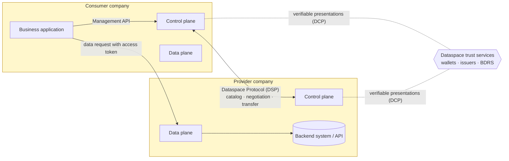

<div class="tx-hero" markdown>

<p class="tx-eyebrow">Eclipse Tractus-X · Dataspace connector</p>

# Tractus-X EDC

The open-source, production-ready **dataspace connector**. Tractus-X EDC packages the
[Eclipse Dataspace Components (EDC)](https://github.com/eclipse-edc/Connector) with the extensions, policies and
identity integration a company needs to share data **in a sovereign and secure way**: in
[Catena-X](https://catena-x.net/), in [Manufacturing-X](https://www.plattform-i40.de/IP/Redaktion/EN/Standardartikel/manufacturing-x.html) dataspaces such
as [Factory-X](https://factory-x.org/) and [Construct-X](https://construct-x.org/), and in any other dataspace that
speaks the Dataspace Protocol. Every part is an extension, so you can add the rules of your own dataspace.

[Get started :material-rocket-launch-outline:](home/overview.md){ .md-button .md-button--primary }
[Deploy a connector :material-kubernetes:](deployment/index.md){ .md-button }
[Read the code :fontawesome-brands-github:](https://github.com/eclipse-tractusx/tractusx-edc){ .md-button }
[Join the open meeting :material-video-outline:](https://eclipse-tractusx.github.io/community/open-meetings#edc-weekly){ .md-button }

</div>

## Install

<div class="tx-install" markdown>

=== "Helm (Kubernetes)"

    ```bash
    helm repo add tractusx-edc https://eclipse-tractusx.github.io/charts/dev
    helm repo update
    helm search repo tractusx-edc/tractusx-connector -l   # released chart versions

    helm install my-connector tractusx-edc/tractusx-connector --version <chart-version> -f my-values.yaml
    ```

    No values file yet? [Deploy in five minutes](deployment/index.md#deploy-in-five-minutes) has copy-paste values
    for a local try-out, with PostgreSQL and Vault or fully in memory.

=== "Docker Compose"

    ```bash
    cat > compose.yaml <<'EOF'
    # Tractus-X EDC in memory (control plane and data plane in one container): for a local try-out only,
    # every restart forgets all assets, policies and contracts. The identity values are placeholders.
    services:
      edc:
        image: tractusx/edc-runtime-memory:0.13.0
        ports:
          - "8080:8080"   # health checks: /api/check/readiness
          - "8081:8081"   # Management API
          - "8084:8084"   # Dataspace Protocol
          - "8086:8086"   # data plane public API
        environment:
          OTEL_JAVAAGENT_ENABLED: "false"
          EDC_PARTICIPANT_ID: did:web:changeme
          EDC_IAM_ISSUER_ID: did:web:changeme
          EDC_PARTICIPANT_CONTEXT_ID: try-participant-context
          TRACTUSX_EDC_PARTICIPANT_BPN: BPNL000000000001
          WEB_HTTP_PORT: "8080"
          WEB_HTTP_PATH: /api
          WEB_HTTP_MANAGEMENT_PORT: "8081"
          WEB_HTTP_MANAGEMENT_PATH: /management
          WEB_HTTP_MANAGEMENT_AUTH_TYPE: tokenbased
          WEB_HTTP_MANAGEMENT_AUTH_KEY: password
          WEB_HTTP_CONTROL_PORT: "8083"
          WEB_HTTP_CONTROL_PATH: /control
          WEB_HTTP_PROTOCOL_PORT: "8084"
          WEB_HTTP_PROTOCOL_PATH: /api/v1/dsp
          WEB_HTTP_PUBLIC_PORT: "8086"
          WEB_HTTP_PUBLIC_PATH: /api/public
          EDC_DSP_CALLBACK_ADDRESS: http://edc:8084/api/v1/dsp
          EDC_DATAPLANE_API_PUBLIC_BASEURL: http://localhost:8086/api/public
          TX_EDC_DATAPLANE_TOKEN_REFRESH_ENDPOINT: http://localhost:8086/api/public/token
          EDC_TRANSFER_PROXY_TOKEN_SIGNER_PRIVATEKEY_ALIAS: key-1
          EDC_TRANSFER_PROXY_TOKEN_VERIFIER_PUBLICKEY_ALIAS: key-1
          EDC_IAM_STS_OAUTH_TOKEN_URL: https://div.example.org/oauth/token
          EDC_IAM_STS_OAUTH_CLIENT_ID: try-client-id
          EDC_IAM_STS_OAUTH_CLIENT_SECRET_ALIAS: try-client-secret
          TX_EDC_IAM_STS_DIV_URL: https://div.example.org
          TX_EDC_IAM_DCP_BDRS_SERVER_URL: https://bdrs.example.org
    EOF

    docker compose up -d
    curl -s -X POST http://localhost:8081/management/v3/assets/request \
      -H "X-Api-Key: password" -H "Content-Type: application/json" \
      -d '{"@context": {"@vocab": "https://w3id.org/edc/v0.0.1/ns/"}, "@type": "QuerySpec"}'
    ```

    The same settings the `tractusx-connector-memory` chart sets; see [Configuration](deployment/configuration.md)
    for the rest. To exchange data with a partner, the connector needs a real wallet: see the next tab. For a
    generated Compose setup with a provider and a consumer, try the
    [Tractus-X Starter Kit](https://github.com/eclipse-tractusx/tractusx-starter-kit).

=== "Full dataspace (Umbrella)"

    ```bash
    git clone https://github.com/eclipse-tractusx/tractus-x-umbrella.git
    cd tractus-x-umbrella/charts/umbrella
    helm dependency update
    helm install -f values-adopter-decentralized-identityhub.yaml umbrella . --namespace umbrella --create-namespace
    ```

    The [Tractus-X Umbrella](https://github.com/eclipse-tractusx/tractus-x-umbrella) runs a whole dataspace on your
    own cluster: a provider and a consumer Tractus-X EDC, each with its own
    [Tractus-X Identity Hub](https://github.com/eclipse-tractusx/tractusx-identityhub) as wallet, an IssuerService
    and the BDRS. Start with its
    [guide for this setup](https://github.com/eclipse-tractusx/tractus-x-umbrella/blob/main/docs/user/common/guides/data-exchange-identityhub.md)
    (cluster prerequisites for Linux, macOS and Windows are linked there).

=== "Docker images"

    ```bash
    docker pull tractusx/edc-controlplane-postgresql-hashicorp-vault:<version>
    docker pull tractusx/edc-dataplane-hashicorp-vault:<version>
    docker pull tractusx/edc-runtime-memory:<version>     # testing only
    ```

    Multi-architecture (`linux/amd64`, `linux/arm64`), non-root, published on
    [Docker Hub](https://hub.docker.com/u/tractusx) for every release. Settings come from environment variables; see
    [Configuration](deployment/configuration.md).

=== "From source"

    ```bash
    git clone https://github.com/eclipse-tractusx/tractusx-edc.git
    cd tractusx-edc
    ./gradlew build          # compile, unit tests, Checkstyle (JDK 21)
    ./gradlew dockerize      # local images of every runtime
    ```

    Then follow [Developer setup](developer/setup.md) or the [local quick start](deployment/local-quickstart.md).

</div>

## Choose your path

<div class="grid cards" markdown>

-   :material-lightbulb-on-outline: **New to dataspaces?**

    ---

    Learn what a connector does, why there are two planes, and how contracts, policies and credentials fit
    together, in plain words.

    [:octicons-arrow-right-24: What is Tractus-X EDC?](home/overview.md)

-   :material-sitemap-outline: **Architect**

    ---

    See the components, the trust model (DCP, DIDs, BDRS), the Catena-X policy model and every data exchange flow
    as diagrams.

    [:octicons-arrow-right-24: Architecture](architecture/index.md)

-   :material-kubernetes: **Operator**

    ---

    Install the Helm chart, configure identity, database and vault, harden for production, and upgrade safely.

    [:octicons-arrow-right-24: Deployment](deployment/index.md)

-   :material-school-outline: **Integrator**

    ---

    Offer your first asset, negotiate a contract and fetch data, step by step with copy-paste requests.

    [:octicons-arrow-right-24: Tutorials](tutorials/index.md)

-   :material-code-braces: **Developer**

    ---

    Build the code, understand the module layout and the extension model, write tests, and contribute.

    [:octicons-arrow-right-24: Developers](developer/index.md)

-   :material-api: **API user**

    ---

    Browse the Management API and data plane API, the Tractus-X specific endpoints and the JSON-LD vocabulary.

    [:octicons-arrow-right-24: Reference](reference/index.md)

</div>

## Why Tractus-X EDC?

Upstream [EDC](https://github.com/eclipse-edc/Connector) is a framework you assemble a connector from. Tractus-X EDC
is that connector, **ready to run** in Catena-X, Manufacturing-X and other dataspaces:

<div class="tx-why" markdown>

-   :material-package-variant-closed: <span>**Released runtimes and OSS images** on Docker Hub, for every release</span>
-   :material-kubernetes: <span>**Helm charts** with PostgreSQL and Vault options, tested on every CI run</span>
-   :material-scale-balance: <span>**Catena-X policies, BPN groups and BDRS** built in, and room for your own</span>
-   :material-puzzle-outline: <span>**Extensible**: add the policies and services of your dataspace as extensions</span>
-   :material-wallet-outline: <span>**Any DCP wallet**: Tractus-X Identity Hub, SAP DIV or your own</span>
-   :material-calendar-sync: <span>**A mature release cycle**: quarterly releases with release candidates and backported fixes, aligned with Eclipse Tractus-X</span>
-   :material-map-marker-path: <span>**An open roadmap**: companies join the public planning and contribute to it</span>
-   :material-update: <span>**Migrations and upgrade guides** for every release, upgradeability tested in CI</span>
-   :material-shield-check-outline: <span>**Security scans and Eclipse license checks** of every dependency</span>
-   :material-account-group-outline: <span>**An open community** with a public Connector Open Meeting</span>
-   :material-factory: <span>**Production-ready** and running in Catena-X today</span>

</div>

[Why Tractus-X EDC :octicons-arrow-right-24:](home/why-tractusx-edc.md){ .md-button }
[Who uses it :octicons-arrow-right-24:](home/known-friends.md){ .md-button }

!!! note "Use in production, at your own risk"

    Tractus-X EDC is built, tested and released for production use, and runs in production in Catena-X. Like any
    open-source software it comes **without warranty** ([Apache License 2.0](https://github.com/eclipse-tractusx/tractusx-edc/blob/main/LICENSE),
    sections 7 and 8): you operate it, and you are responsible for securing, configuring and updating it. Start with
    the [production checklist](deployment/production-checklist.md).

## The connector in one picture



The **control plane** negotiates *whether* data may flow: it publishes offers, checks policies against verifiable
credentials and records contracts. The **data plane** moves the data once a contract exists. Neither company hands
its data to a central platform. [Learn more :octicons-arrow-right-24:](home/overview.md)

## Part of the Connector KIT

<div class="tx-kit" markdown>

{ .tx-kit__image width="240" height="224" }

<div class="tx-kit__body" markdown>

<p class="tx-kit__eyebrow">Eclipse Tractus-X Connector KIT</p>

The [Connector KIT](https://eclipse-tractusx.github.io/docs-kits/kits/connector-kit/adoption-view/) describes the
basic infrastructure for cross-enterprise data exchange in a dataspace: the Dataspace Protocol, identities and
credentials, policies and asset design. **Tractus-X EDC is its reference implementation**: production-ready, in
use throughout the Catena-X dataspace, and reused by other dataspaces such as Construct-X.

[Open the Connector KIT :octicons-arrow-right-24:](https://eclipse-tractusx.github.io/docs-kits/kits/connector-kit/adoption-view/){ .md-button .md-button--primary }
[Operation view](https://eclipse-tractusx.github.io/docs-kits/kits/connector-kit/operation-view/){ .md-button }
[Development view](https://eclipse-tractusx.github.io/docs-kits/kits/connector-kit/software-development-view/architecture/){ .md-button }

</div>

</div>

## Popular pages

| I want to… | Go to |
|---|---|
| Run two connectors on my laptop | [Local quick start](deployment/local-quickstart.md) |
| Exchange data for the first time | [Tutorial 1: your first data exchange](tutorials/first-data-exchange.md) |
| Write a Catena-X compliant policy | [Catena-X policies](architecture/policies.md) |
| Understand EDRs and token refresh | [EDRs and token refresh](architecture/edr-and-token-refresh.md) |
| Configure the Helm chart | [Helm chart](deployment/helm-chart.md) |
| Upgrade to a new release | [Upgrades and migrations](deployment/upgrades.md), [Changelog](changelog/index.md) |
| Run it in production | [Production checklist](deployment/production-checklist.md), [Tune for production](operations/tuning.md) |
| Use it in another dataspace | [Supported dataspaces](dataspaces/index.md), [Create a dataspace extension](dataspaces/create-extension.md) |
| Fix a failing negotiation or transfer | [Troubleshooting](operations/troubleshooting.md) |
| Write my own extension | [Tutorial 4: your first extension](tutorials/first-extension.md) |
| Find every page | [Documentation map](home/documentation-map.md) |

!!! tip "Ask the Connector Sensei"

    This repository ships an AI agent, the [Connector Sensei](development/connector-sensei/README.md), for GitHub
    Copilot and Claude Code. It answers questions about Tractus-X EDC and upstream EDC from the source code at the exact
    pinned version, and cites `file:line`.

## Talk to the community

<div class="grid cards" markdown>

-   :material-video-outline: **Connector Open Meeting**

    ---

    Every second Tuesday, open to everyone: questions, demos and what is coming next for Tractus-X EDC.

    [Join the meeting :octicons-arrow-right-24:](https://eclipse-tractusx.github.io/community/open-meetings#edc-weekly){ .md-button .md-button--primary }

-   :material-forum-outline: **Community Office Hour**

    ---

    The weekly open hour of Eclipse Tractus-X for all topics, from your first steps to contributing.

    [Join the office hour :octicons-arrow-right-24:](https://eclipse-tractusx.github.io/community/open-meetings#community-office-hour){ .md-button .md-button--primary }

-   :material-chat-outline: **Matrix chat**

    ---

    Ask the committers and other adopters any time in the Tractus-X EDC room on the Eclipse Matrix server.

    [Open the chat :octicons-arrow-right-24:](https://chat.eclipse.org/#/room/#tractusx-edc:matrix.eclipse.org){ .md-button .md-button--primary }

-   :material-bug-outline: **Open an issue**

    ---

    Found a bug or missing a feature? Tell us on GitHub, with the version you run and the steps to reproduce it.

    [Open an issue :octicons-arrow-right-24:](https://github.com/eclipse-tractusx/tractusx-edc/issues/new/choose){ .md-button .md-button--primary }

</div>

Tractus-X EDC is developed in the open by the [Eclipse Tractus-X](https://eclipse-tractusx.github.io/) project.
Releases, Docker images and Helm charts are published from
[GitHub](https://github.com/eclipse-tractusx/tractusx-edc/releases), and every release is listed in the
[changelog](changelog/index.md). Longer questions go to
[GitHub Discussions](https://github.com/eclipse-tractusx/tractusx-edc/discussions).

[All channels :octicons-arrow-right-24:](home/get-help.md){ .md-button }
[GitHub Discussions :fontawesome-brands-github:](https://github.com/eclipse-tractusx/tractusx-edc/discussions){ .md-button }

## NOTICE

This work is licensed under the [CC-BY-4.0](https://creativecommons.org/licenses/by/4.0/legalcode).

- AI Disclosure: This file was entirely AI-generated. The AI-generated portions are made available under CC0-1.0 and
  not subject to the project's license. The human contributor has reviewed and verified that the content is correct.
- SPDX-License-Identifier: CC-BY-4.0 AND CC0-1.0
- SPDX-FileCopyrightText: 2026 Catena-X Automotive Network e.V.
- SPDX-FileCopyrightText: 2026 Contributors to the Eclipse Foundation
- Assisted-By: GitHub Copilot (claude-opus-5.5)
- Source URL: <https://github.com/eclipse-tractusx/tractusx-edc>
