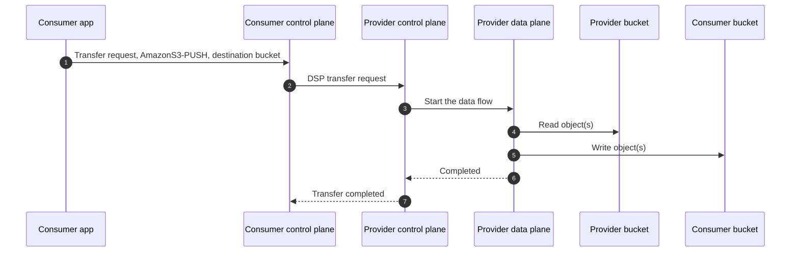

# Amazon S3

The data plane of Tractus-X EDC can read objects from an S3 bucket and write them into the consumer's bucket. The
transfer type is **`AmazonS3-PUSH`**: the provider's data plane copies the data, the consumer only names its
destination. Any S3-compatible store (MinIO, Ceph, the S3 API of other clouds) works through `endpointOverride`.



## 1. Credentials

The data plane finds AWS credentials in this order:

| Where | How | Use it for |
|---|---|---|
| In the data address, by vault reference | `keyName` names a vault secret that holds `{"accessKeyId": "…", "secretAccessKey": "…"}` (add `"sessionToken"` for temporary credentials) | **Recommended for the provider.** No secret in the asset. |
| In the data address, inline | `accessKeyId` and `secretAccessKey` properties | Tests and the consumer's destination, which is sent to the provider anyway |
| For the whole data plane | `dataplane.aws.accessKeyId` / `dataplane.aws.secretAccessKey` in the chart (environment variables `AWS_ACCESS_KEY_ID` / `AWS_SECRET_ACCESS_KEY`) | One account for all assets |
| From the platform | The AWS SDK default chain: IAM role of the pod ([IRSA](https://docs.aws.amazon.com/eks/latest/userguide/iam-roles-for-service-accounts.html) or EKS Pod Identity), instance profile | **Recommended on EKS.** No keys at all. |

!!! warning "The consumer's destination credentials reach the provider"

    The provider's data plane writes into the consumer's bucket, so the destination address, credentials included,
    goes to the provider. Give the consumer's destination a key that can **only write** to that bucket or prefix, and
    rotate it.

## 2. Provider: offer an object

```http
POST /management/v3/assets HTTP/1.1
Host: provider-controlplane
X-Api-Key: <management API key>
Content-Type: application/json
```

```json
{
  "@context": { "@vocab": "https://w3id.org/edc/v0.0.1/ns/" },
  "@type": "Asset",
  "@id": "s3-measurements",
  "properties": { "name": "Measurements 2026" },
  "dataAddress": {
    "@type": "DataAddress",
    "type": "AmazonS3",
    "region": "eu-central-1",
    "bucketName": "provider-data",
    "objectName": "measurements/2026.csv",
    "keyName": "s3-provider-data-credentials"
  }
}
```

| Property | Meaning |
|---|---|
| `region`, `bucketName` | Where the data lives. Required. |
| `objectName` | One object. |
| `objectPrefix` | Instead of `objectName`: every object under this prefix. |
| `keyName` | Vault alias of the credentials (section 1). Leave out to use the data plane's credentials. |
| `endpointOverride` | URL of an S3-compatible store, for example `https://minio.example.com`. |

Store the secret under the alias first, for example in HashiCorp Vault:

```bash
vault kv put secret/s3-provider-data-credentials \
  content='{"accessKeyId":"AKIA…","secretAccessKey":"…"}'
```

The chart's HashiCorp Vault settings are under `vault.hashicorp` (see [Configuration](../deployment/configuration.md));
the secret path and field name depend on them.

Then add a policy and a contract definition as for any asset ([tutorial 1](../tutorials/first-data-exchange.md)). The
catalog now offers the dataset with the distribution format `AmazonS3-PUSH`.

## 3. Consumer: request the transfer

After the contract negotiation, start the transfer with the agreement and your bucket as destination:

```http
POST /management/v3/transferprocesses HTTP/1.1
Host: consumer-controlplane
X-Api-Key: <management API key>
Content-Type: application/json
```

```json
{
  "@context": { "@vocab": "https://w3id.org/edc/v0.0.1/ns/" },
  "@type": "TransferRequest",
  "protocol": "dataspace-protocol-http:2025-1",
  "counterPartyAddress": "https://provider.example.com/api/v1/dsp/2025-1",
  "contractId": "<contract agreement id>",
  "transferType": "AmazonS3-PUSH",
  "dataDestination": {
    "@type": "DataAddress",
    "type": "AmazonS3",
    "region": "eu-west-1",
    "bucketName": "consumer-inbox",
    "objectName": "measurements-2026.csv",
    "accessKeyId": "<write-only key id>",
    "secretAccessKey": "<write-only secret>"
  }
}
```

Use `folderName` instead of `objectName` to keep the source names under a folder. Follow the transfer with
`GET /management/v3/transferprocesses/<id>/state` until it is `COMPLETED`; then the object is in your bucket.

## 4. Settings

| Setting | Effect |
|---|---|
| `dataplane.aws.endpointOverride` (`EDC_AWS_ENDPOINT_OVERRIDE`) | Default endpoint for all S3 calls, for an S3-compatible store |
| `edc.dataplane.aws.sink.chunk.size.mb` | Size of the parts of a multipart upload into the destination |
| `edc.aws.client.async.thread-pool-size` | Threads of the AWS client |

## Try it locally

The repository's end-to-end tests run this flow against [MinIO](https://min.io/) containers:
[`S3ToS3EndToEndTest`](../../edc-tests/e2e/end2end-transfer-cloud/src/test/java/org/eclipse/tractusx/edc/tests/transfer/S3ToS3EndToEndTest.java)
and, across clouds,
[`MultiCloudTest`](../../edc-tests/e2e/cloud-transfer-tests/src/test/java/org/eclipse/tractusx/edc/dataplane/transfer/test/MultiCloudTest.java).
They are the most exact reference for the request shapes.

## Running the connector on AWS

To deploy the connector itself on AWS (EKS, RDS for PostgreSQL, Secrets Manager), see
[Platforms](../deployment/platforms.md#amazon-web-services).


## NOTICE

This work is licensed under the [CC-BY-4.0](https://creativecommons.org/licenses/by/4.0/legalcode).

- AI Disclosure: This file was entirely AI-generated. The AI-generated portions are made available under CC0-1.0 and
  not subject to the project's license. The human contributor has reviewed and verified that the content is correct.
- SPDX-License-Identifier: CC-BY-4.0 AND CC0-1.0
- SPDX-FileCopyrightText: 2026 Catena-X Automotive Network e.V.
- SPDX-FileCopyrightText: 2026 Contributors to the Eclipse Foundation
- Assisted-By: Claude Code (claude-opus-5-5)
- Source URL: <https://github.com/eclipse-tractusx/tractusx-edc>
