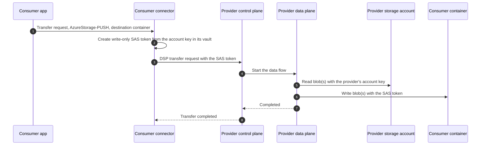

# Azure Blob Storage

The data plane of Tractus-X EDC can read blobs from an Azure storage account and write them into the consumer's
container. The transfer type is **`AzureStorage-PUSH`**: the provider's data plane copies the data, the consumer only
names its destination.

Unlike S3, no account key leaves its owner: the consumer's connector creates a short-lived, write-only **SAS token**
for its container and sends only that to the provider.



## 1. Keys in the vault

| Who | Vault secret | Value |
|---|---|---|
| Provider | Any alias, named in the asset's `keyName` | The storage account key of the source account |
| Consumer | The **name of the storage account** | The storage account key of the destination account |

The storage account keys never appear in the Management API.

## 2. Provider: offer a blob

```http
POST /management/v3/assets HTTP/1.1
Host: provider-controlplane
X-Api-Key: <management API key>
Content-Type: application/json
```

```json
{
  "@context": { "@vocab": "https://w3id.org/edc/v0.0.1/ns/" },
  "@type": "Asset",
  "@id": "blob-measurements",
  "properties": { "name": "Measurements 2026" },
  "dataAddress": {
    "@type": "DataAddress",
    "type": "AzureStorage",
    "account": "providerdata",
    "container": "measurements",
    "blobName": "2026.csv",
    "keyName": "providerdata-key"
  }
}
```

| Property | Meaning |
|---|---|
| `account`, `container` | Where the data lives. Required. |
| `blobName` | One blob. |
| `blobPrefix` | Instead of `blobName`: every blob under this prefix, for example `folder/`. |
| `keyName` | Vault alias of the account key (section 1). Required. |

Add a policy and a contract definition as for any asset ([tutorial 1](../tutorials/first-data-exchange.md)). The
catalog now offers the dataset with the distribution format `AzureStorage-PUSH`.

## 3. Consumer: request the transfer

After the contract negotiation:

```http
POST /management/v3/transferprocesses HTTP/1.1
Host: consumer-controlplane
X-Api-Key: <management API key>
Content-Type: application/json
```

```json
{
  "@context": { "@vocab": "https://w3id.org/edc/v0.0.1/ns/" },
  "@type": "TransferRequest",
  "protocol": "dataspace-protocol-http:2025-1",
  "counterPartyAddress": "https://provider.example.com/api/v1/dsp/2025-1",
  "contractId": "<contract agreement id>",
  "transferType": "AzureStorage-PUSH",
  "dataDestination": {
    "@type": "DataAddress",
    "type": "AzureStorage",
    "account": "consumerinbox",
    "container": "incoming",
    "folderName": "measurements"
  }
}
```

The container must exist. `folderName` is optional: without it, the blobs land at the top of the container with
their source names. Follow the transfer with `GET /management/v3/transferprocesses/<id>/state` until it is
`COMPLETED`.

## 4. Settings

| Setting | Effect |
|---|---|
| `edc.blobstore.endpoint.template` | Endpoint of the blob service, `%s` stands for the account name. Default: `https://%s.blob.core.windows.net`. Set it for Azurite or sovereign clouds. |
| `edc.azure.block.size.mb`, `edc.azure.max.concurrency`, `edc.azure.max.single.upload.size.mb` | Upload tuning of the data plane |

Set them as environment variables in `dataplane.env` (and `controlplane.env` for the endpoint template), see
[Configuration](../deployment/configuration.md).

## Try it locally

The repository's end-to-end tests run this flow against [Azurite](https://github.com/Azure/Azurite):
[`AzureToAzureEndToEndTest`](../../edc-tests/e2e/end2end-transfer-cloud/src/test/java/org/eclipse/tractusx/edc/tests/transfer/AzureToAzureEndToEndTest.java)
and, across clouds,
[`MultiCloudTest`](../../edc-tests/e2e/cloud-transfer-tests/src/test/java/org/eclipse/tractusx/edc/dataplane/transfer/test/MultiCloudTest.java).

## Running the connector on Azure

To deploy the connector itself on Azure (AKS, Azure Database for PostgreSQL, Key Vault), see
[Platforms](../deployment/platforms.md#microsoft-azure).


## NOTICE

This work is licensed under the [CC-BY-4.0](https://creativecommons.org/licenses/by/4.0/legalcode).

- AI Disclosure: This file was entirely AI-generated. The AI-generated portions are made available under CC0-1.0 and
  not subject to the project's license. The human contributor has reviewed and verified that the content is correct.
- SPDX-License-Identifier: CC-BY-4.0 AND CC0-1.0
- SPDX-FileCopyrightText: 2026 Catena-X Automotive Network e.V.
- SPDX-FileCopyrightText: 2026 Contributors to the Eclipse Foundation
- Assisted-By: Claude Code (claude-opus-5-5)
- Source URL: <https://github.com/eclipse-tractusx/tractusx-edc>
