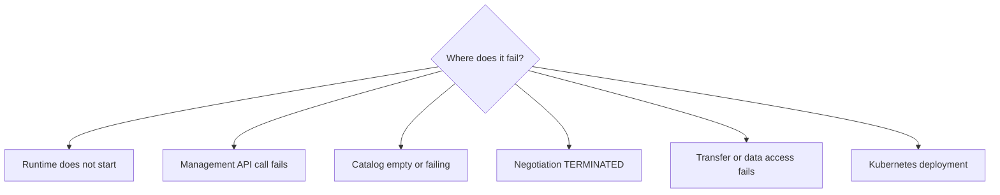

# Troubleshooting

Find your symptom, check the likely causes in order, apply the fix. If you are stuck, open a
[discussion](https://github.com/eclipse-tractusx/tractusx-edc/discussions) with the log lines and your (redacted) values.

## The runtime does not start

| Symptom | Likely cause | Fix |
|---|---|---|
| `The participant context id has not been set, it is a mandatory setting now` | `edc.participant.context.id` is missing; the database migration needs it | Set `participant.contextId` in the chart (env `EDC_PARTICIPANT_CONTEXT_ID`). Never change it afterwards. |
| Flyway error, or `column … does not exist` | Migrations disabled, or the database is ahead of or behind the image | Keep `tx.edc.postgresql.migration.enabled=true`; check the `flyway_schema_history` table; read the [migration guide](../migration/index.md) of the version you came from. |
| Missing-setting error at boot | A required setting has no value | The message names the key. Look it up with the `setting-lifecycle` skill or in [Configuration](../deployment/configuration.md). |
| Vault errors on every secret | HashiCorp Vault 1.18.1, wrong token or wrong `paths.secret` | Use a different Vault version; check `vault.hashicorp.url`, the token and `vault.hashicorp.paths.secret` (default `/v1/secret`). |
| Pod restarts after ~90 s | Liveness probe fails while the runtime is still booting or the database is slow | Look at the log for the real error first; increase `livenessProbe.initialDelaySeconds` if boot is just slow. |

## Management API calls fail

| Symptom | Likely cause | Fix |
|---|---|---|
| `401 Unauthorized` | Wrong or missing `X-Api-Key`, or delegated auth is configured | Use the value of `controlplane.endpoints.management.authKey`. With `jwksUrl` set, send a JWT instead. |
| `404` on a path that should exist | Wrong base path or port | Management is `:8081/management` in the chart, so paths look like `/management/v3/assets`. |
| `400` when creating a policy | Catena-X policy validation rejected it | The response lists the failing constraint. Compare with [Catena-X policies](../architecture/policies.md): action `access` vs `use`, operator, right operand type (array for `isAnyOf`). |
| `400` when creating a contract definition | Access policy must have action `access` and contract policy action `use`; or an empty asset selector is blocked | Fix the referenced policies. The empty-selector blocker is controlled by `tx.edc.validator.contractdefinitions.block-empty-asset-selector` (default `false`). |
| `400` with a JSON-LD message | A term does not expand to the IRI you expect | Check the `@context`; with `@vocab` every unknown term becomes an EDC term. |

## The catalog is empty or the request fails

Work through the identity chain, consumer first, then provider:

1. **Consumer can get a token.** Its STS / DIV settings (`dcp.sts.*`) are correct and the client secret exists in Vault
   under `dcp.sts.oauth.client.secret_alias`.
2. **Consumer has the credentials.** A `MembershipCredential` (and for DSP 2025-1 also `DataExchangeGovernanceCredential`
   and `BpnCredential`) exists in its wallet and is not expired or revoked.
3. **Provider trusts the issuer.** The issuer's DID is in the provider's `dcp.trustedIssuers`.
4. **Provider can resolve the BPN.** `controlplane.bdrs.server.url` points to a reachable BDRS.
5. **Addresses and protocol match.** `counterPartyAddress` ends with `/api/v1/dsp/2025-1` for
   `dataspace-protocol-http:2025-1`, and `counterPartyId` is the provider's DID (BPNL for DSP 0.8). Use
   [connector discovery](../architecture/flows.md#connector-discovery) when unsure.
6. **The access policy admits you.** If everything else works but one dataset is missing, its access policy (for
   example a `BusinessPartnerGroup`) excludes you.

The detailed identity flow is in [Identity and trust](../architecture/identity-and-trust.md).

## A negotiation ends in `TERMINATED`

| Cause | Fix |
|---|---|
| The offer in your request is not **identical** to the one in the catalog | Copy the policy from `odrl:hasPolicy` unchanged; add only `assigner` and `target`. |
| You do not satisfy the contract policy | Check credentials for `FrameworkAgreement` / `Membership`; read `errorDetail` of the negotiation. |
| Wrong `assigner` | Use the provider's DID (DSP 2025-1) or BPNL (DSP 0.8). |

## Transfers and data access

| Symptom | Likely cause | Fix |
|---|---|---|
| Transfer `TERMINATED` right after the request | Agreement retired or expired, or the transfer-time policy fails | Check `/v3/contractagreements/retirements/request` on the provider and the `errorDetail` of the transfer. |
| `401` from the provider data plane | Token expired | Fetch the EDR with `auto_refresh=true`, or use the consumer proxy. |
| Refresh returns `401` repeatedly | Consumer lost the rotated refresh token (older versions), or the refresh request is not authenticated with the consumer's identity | Upgrade; current versions accept the previous refresh token until the new one is used. Restart the transfer as a last resort. |
| Consumer proxy unreachable after changing its port | The port is configured in two places | When you change `dataplane.endpoints.proxy.port`, also set `TX_EDC_DPF_CONSUMER_PROXY_PORT`. |
| Upload or multipart request fails with a file system error | `readOnlyRootFilesystem: true` and the temp directory is not writable | Make sure temporary files go to the writable `/tmp` volume; as a last resort relax the security context. |
| Provider data plane cannot reach the backend | `baseUrl` not reachable from the data plane pod, or backend credentials missing in Vault | Test from the pod; check the secret alias in the asset's `dataAddress`. |

## Kubernetes deployment

| Symptom | Likely cause | Fix |
|---|---|---|
| `no matches for kind "HorizontalPodAutoscaler" in version "autoscaling/v2beta1"` | The chart's HPA templates use an API that current Kubernetes no longer serves | Keep `autoscaling.enabled: false` and scale with `replicaCount`, or provide your own HPA. |
| `helm install` fails with a `required` error | A mandatory value is empty | Set it, or a non-empty placeholder if the real value comes from a Secret (see [Configuration](../deployment/configuration.md#passing-secrets-safely)). |
| Data lost after a pod restart | Bundled PostgreSQL without persistence or Vault in dev mode | Use external PostgreSQL and Vault ([production checklist](../deployment/production-checklist.md)). |
| Partners get `http://` URLs | TLS not enabled on the first ingress | Set `tls.enabled: true` on the protocol/public ingress; the chart then advertises `https://`. |

## Ask the Sensei

The [Connector Sensei](../development/connector-sensei/README.md) can read your logs and settings against the code at
your exact version, and point to the line that rejects your request.

## NOTICE

This work is licensed under the [CC-BY-4.0](https://creativecommons.org/licenses/by/4.0/legalcode).

- AI Disclosure: This file was entirely AI-generated. The AI-generated portions are made available under CC0-1.0 and
  not subject to the project's license. The human contributor has reviewed and verified that the content is correct.
- SPDX-License-Identifier: CC-BY-4.0 AND CC0-1.0
- SPDX-FileCopyrightText: 2026 Catena-X Automotive Network e.V.
- SPDX-FileCopyrightText: 2026 Contributors to the Eclipse Foundation
- Assisted-By: GitHub Copilot (claude-opus-5.5)
- Source URL: <https://github.com/eclipse-tractusx/tractusx-edc>
