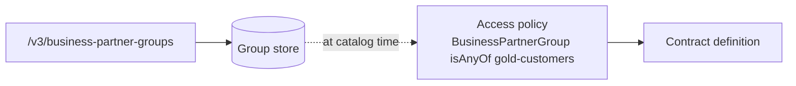

# Tutorial 2: Control access with BPN groups

You want to show an offer only to some partners, for example your *gold customers*. Writing their BPNs into the policy
works, but every new customer would need a new policy and contract definition. **Business partner groups** solve this:
the policy names a group, and you maintain group membership separately.



**Time:** about 15 minutes. **You need:** a provider (and ideally a consumer) and the shell variables from the
[tutorials overview](index.md#conventions). It builds on [Tutorial 1](first-data-exchange.md).

## 1. Put a partner into a group

The body is JSON-LD: `@id` is the partner's BPNL, and `tx:groups` lists its groups.

```bash
export CONSUMER_BPN=BPNL000000000002

curl -s -X POST "$PROVIDER_MGMT/v3/business-partner-groups" \
  -H "X-Api-Key: $PROVIDER_KEY" -H "Content-Type: application/json" \
  -d '{
    "@context": { "tx": "https://w3id.org/tractusx/v0.0.1/ns/" },
    "@id": "'"$CONSUMER_BPN"'",
    "tx:groups": ["gold-customers"]
  }'
```

A `204` means success. Check it:

```bash
curl -s "$PROVIDER_MGMT/v3/business-partner-groups/$CONSUMER_BPN" -H "X-Api-Key: $PROVIDER_KEY"
curl -s "$PROVIDER_MGMT/v3/business-partner-groups/group/gold-customers" -H "X-Api-Key: $PROVIDER_KEY"
```

## 2. Create an access policy for the group

```bash
curl -s -X POST "$PROVIDER_MGMT/v3/policydefinitions" \
  -H "X-Api-Key: $PROVIDER_KEY" -H "Content-Type: application/json" \
  -d '{
    "@context": [
      "https://w3id.org/dspace/2025/1/odrl-profile.jsonld",
      "https://w3id.org/catenax/2025/9/policy/context.jsonld",
      { "@vocab": "https://w3id.org/edc/v0.0.1/ns/" }
    ],
    "@type": "PolicyDefinition",
    "@id": "access-gold",
    "policy": {
      "@type": "Set",
      "permission": [{
        "action": "access",
        "constraint": [{ "and": [
          { "leftOperand": "Membership", "operator": "eq", "rightOperand": "active" },
          { "leftOperand": "BusinessPartnerGroup", "operator": "isAnyOf", "rightOperand": ["gold-customers"] }
        ]}]
      }]
    }
  }'
```

`isAnyOf` means "the partner is in **at least one** of these groups". Use `isNoneOf` to exclude groups instead.

## 3. Offer an asset to the group

Reuse the asset and usage policy from Tutorial 1:

```bash
curl -s -X POST "$PROVIDER_MGMT/v3/contractdefinitions" \
  -H "X-Api-Key: $PROVIDER_KEY" -H "Content-Type: application/json" \
  -d '{
    "@context": { "@vocab": "https://w3id.org/edc/v0.0.1/ns/" },
    "@type": "ContractDefinition",
    "@id": "todo-offer-gold",
    "accessPolicyId": "access-gold",
    "contractPolicyId": "usage-quality",
    "assetsSelector": {
      "@type": "Criterion",
      "operandLeft": "https://w3id.org/edc/v0.0.1/ns/id",
      "operator": "=",
      "operandRight": "todo-api"
    }
  }'
```

## 4. Try it

1. Request the catalog as the consumer (Tutorial 1, step 4). You see an offer from `todo-offer-gold`.
2. Remove the consumer from the group:

    ```bash
    curl -s -X PUT "$PROVIDER_MGMT/v3/business-partner-groups" \
      -H "X-Api-Key: $PROVIDER_KEY" -H "Content-Type: application/json" \
      -d '{ "@context": { "tx": "https://w3id.org/tractusx/v0.0.1/ns/" },
            "@id": "'"$CONSUMER_BPN"'", "tx:groups": ["silver-customers"] }'
    ```

3. Request the catalog again. The offer from `todo-offer-gold` is gone, **without any change to the policy**. (If the
   old contract definition from Tutorial 1 still exists, its offer remains visible.)

!!! info "Groups gate the catalog, not existing agreements"

    `BusinessPartnerGroup` is an **access** constraint and is evaluated when the catalog is requested. Agreements that
    were already negotiated stay valid. To end one, [retire the agreement](../architecture/flows.md#agreement-retirement).

## Clean up

```bash
curl -s -X DELETE "$PROVIDER_MGMT/v3/business-partner-groups/$CONSUMER_BPN" -H "X-Api-Key: $PROVIDER_KEY"
```

**Next:** [Tutorial 3: consume data with EDRs](consume-with-edrs.md).

## NOTICE

This work is licensed under the [CC-BY-4.0](https://creativecommons.org/licenses/by/4.0/legalcode).

- AI Disclosure: This file was entirely AI-generated. The AI-generated portions are made available under CC0-1.0 and
  not subject to the project's license. The human contributor has reviewed and verified that the content is correct.
- SPDX-License-Identifier: CC-BY-4.0 AND CC0-1.0
- SPDX-FileCopyrightText: 2026 Catena-X Automotive Network e.V.
- SPDX-FileCopyrightText: 2026 Contributors to the Eclipse Foundation
- Assisted-By: GitHub Copilot (claude-opus-5.5)
- Source URL: <https://github.com/eclipse-tractusx/tractusx-edc>
