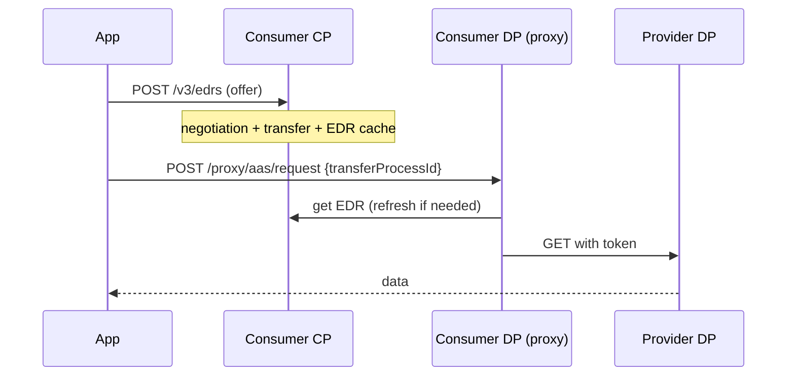

# Tutorial 3: Consume data with EDRs

In Tutorial 1 you negotiated, started a transfer and fetched a token in separate steps. Applications usually want
less ceremony. Tractus-X EDC offers two helpers on the consumer side:

- the **EDR API** `POST /v3/edrs`, which negotiates and starts the transfer in one call;
- the **consumer proxy** on the consumer data plane, which finds the right token, refreshes it and fetches the data.



**Time:** about 15 minutes. **You need:** the provider setup and offer id from [Tutorial 1](first-data-exchange.md).

## 1. Negotiate and transfer in one call

The body is the same `ContractRequest` as in Tutorial 1, step 5. Only the URL changes:

```bash
curl -s -X POST "$CONSUMER_MGMT/v3/edrs" \
  -H "X-Api-Key: $CONSUMER_KEY" -H "Content-Type: application/json" \
  -d @contract-request.json
```

Save the `ContractRequest` from Tutorial 1 as `contract-request.json`. The response contains a negotiation id. Once the
negotiation is `FINALIZED`, the connector starts an `HttpData-PULL` transfer by itself and caches the EDR.

## 2. Find your EDR

```bash
curl -s -X POST "$CONSUMER_MGMT/v3/edrs/request" \
  -H "X-Api-Key: $CONSUMER_KEY" -H "Content-Type: application/json" \
  -d '{
    "@context": { "@vocab": "https://w3id.org/edc/v0.0.1/ns/" },
    "@type": "QuerySpec",
    "filterExpression": [{ "operandLeft": "assetId", "operator": "=", "operandRight": "todo-api" }]
  }'
```

Each entry has `transferProcessId`, `agreementId`, `assetId`, `providerId` and `contractNegotiationId`.

```bash
export TRANSFER_ID='<transferProcessId>'
```

## 3a. Fetch data yourself, with auto-refresh

```bash
EDR=$(curl -s "$CONSUMER_MGMT/v3/edrs/$TRANSFER_ID/dataaddress?auto_refresh=true" -H "X-Api-Key: $CONSUMER_KEY")
curl -s "$(echo "$EDR" | jq -r .endpoint)/1" -H "Authorization: $(echo "$EDR" | jq -r .authorization)"
```

With `auto_refresh=true` (the default), you always get a token that is still valid.

## 3b. Or let the consumer proxy do it

The consumer data plane exposes `POST /proxy/aas/request` (port 8186 in the chart). It is protected by its own API key,
`dataplane.endpoints.proxy.authKey`.

```bash
export CONSUMER_PROXY=http://consumer-data.plane:8186/proxy
export PROXY_KEY=password

curl -s -X POST "$CONSUMER_PROXY/aas/request" \
  -H "X-Api-Key: $PROXY_KEY" -H "Content-Type: application/json" \
  -d '{ "transferProcessId": "'"$TRANSFER_ID"'", "pathSegments": "/1", "queryParams": "foo=bar" }'
```

Instead of `transferProcessId` you can send `assetId` + `providerId`. Despite the `/aas/` in the path, the proxy works
for any HTTP asset.

!!! warning "Keep the proxy internal"

    The proxy uses *your* agreements and tokens. Expose it only to your own applications, never through a public
    ingress.

## 4. Clean up

```bash
curl -s -X DELETE "$CONSUMER_MGMT/v3/edrs/$TRANSFER_ID" -H "X-Api-Key: $CONSUMER_KEY"
```

You rarely need this: the EDR is removed automatically when the transfer is terminated or suspended.

## What you learned

- `POST /v3/edrs` collapses negotiation and transfer.
- `GET /v3/edrs/{id}/dataaddress` always returns a valid token.
- The consumer proxy hides EDR handling from your applications.

Background: [EDRs and token refresh](../architecture/edr-and-token-refresh.md).
**Next:** [Tutorial 4: write your first extension](first-extension.md).

## NOTICE

This work is licensed under the [CC-BY-4.0](https://creativecommons.org/licenses/by/4.0/legalcode).

- AI Disclosure: This file was entirely AI-generated. The AI-generated portions are made available under CC0-1.0 and
  not subject to the project's license. The human contributor has reviewed and verified that the content is correct.
- SPDX-License-Identifier: CC-BY-4.0 AND CC0-1.0
- SPDX-FileCopyrightText: 2026 Catena-X Automotive Network e.V.
- SPDX-FileCopyrightText: 2026 Contributors to the Eclipse Foundation
- Assisted-By: GitHub Copilot (claude-opus-5.5)
- Source URL: <https://github.com/eclipse-tractusx/tractusx-edc>
