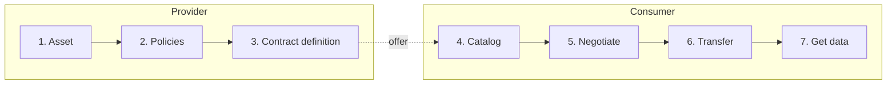

# Tutorial 1: Your first data exchange

In this tutorial you share a small JSON API from a provider with a consumer, using the classic five steps of a
dataspace exchange.



**Time:** about 20 minutes. **You need:** two connectors and the shell variables from the
[tutorials overview](index.md#conventions).

## Provider side

### 1. Create an asset

An asset describes *what* you share and *where* the data plane fetches it from. Here the backend is a public demo API.

```bash
curl -s -X POST "$PROVIDER_MGMT/v3/assets" \
  -H "X-Api-Key: $PROVIDER_KEY" -H "Content-Type: application/json" \
  -d '{
    "@context": { "@vocab": "https://w3id.org/edc/v0.0.1/ns/" },
    "@type": "Asset",
    "@id": "todo-api",
    "properties": { "description": "Demo to-do API" },
    "dataAddress": {
      "@type": "DataAddress",
      "type": "HttpData",
      "baseUrl": "https://jsonplaceholder.typicode.com/todos",
      "proxyPath": "true",
      "proxyQueryParams": "true"
    }
  }'
```

`proxyPath` and `proxyQueryParams` let the consumer append a path (`/1`) and query parameters to the request. The
consumer never sees `baseUrl`; only the provider data plane does.

### 2. Create an access policy and a usage policy

```bash
CONTEXT='[
  "https://w3id.org/dspace/2025/1/odrl-profile.jsonld",
  "https://w3id.org/catenax/2025/9/policy/context.jsonld",
  { "@vocab": "https://w3id.org/edc/v0.0.1/ns/" }
]'

# Who may SEE the offer: active Catena-X members
curl -s -X POST "$PROVIDER_MGMT/v3/policydefinitions" \
  -H "X-Api-Key: $PROVIDER_KEY" -H "Content-Type: application/json" \
  -d '{
    "@context": '"$CONTEXT"',
    "@type": "PolicyDefinition",
    "@id": "access-members",
    "policy": {
      "@type": "Set",
      "permission": [{
        "action": "access",
        "constraint": [{ "leftOperand": "Membership", "operator": "eq", "rightOperand": "active" }]
      }]
    }
  }'

# Under which TERMS the data may be USED
curl -s -X POST "$PROVIDER_MGMT/v3/policydefinitions" \
  -H "X-Api-Key: $PROVIDER_KEY" -H "Content-Type: application/json" \
  -d '{
    "@context": '"$CONTEXT"',
    "@type": "PolicyDefinition",
    "@id": "usage-quality",
    "policy": {
      "@type": "Set",
      "permission": [{
        "action": "use",
        "constraint": { "and": [
          { "leftOperand": "FrameworkAgreement", "operator": "eq", "rightOperand": "DataExchangeGovernance:1.0" },
          { "leftOperand": "UsagePurpose", "operator": "isAnyOf", "rightOperand": ["cx.core.qualityNotifications:1"] }
        ]}
      }]
    }
  }'
```

If a request is rejected with **400**, read the message: policy validation tells you which constraint is wrong. See
[Catena-X policies](../architecture/policies.md).

### 3. Create a contract definition

The contract definition publishes the asset with both policies.

```bash
curl -s -X POST "$PROVIDER_MGMT/v3/contractdefinitions" \
  -H "X-Api-Key: $PROVIDER_KEY" -H "Content-Type: application/json" \
  -d '{
    "@context": { "@vocab": "https://w3id.org/edc/v0.0.1/ns/" },
    "@type": "ContractDefinition",
    "@id": "todo-offer",
    "accessPolicyId": "access-members",
    "contractPolicyId": "usage-quality",
    "assetsSelector": {
      "@type": "Criterion",
      "operandLeft": "https://w3id.org/edc/v0.0.1/ns/id",
      "operator": "=",
      "operandRight": "todo-api"
    }
  }'
```

The provider is done. :material-check:

## Consumer side

### 4. Request the catalog

```bash
curl -s -X POST "$CONSUMER_MGMT/v3/catalog/request" \
  -H "X-Api-Key: $CONSUMER_KEY" -H "Content-Type: application/json" \
  -d '{
    "@context": { "@vocab": "https://w3id.org/edc/v0.0.1/ns/" },
    "@type": "CatalogRequest",
    "counterPartyId": "'"$PROVIDER_DID"'",
    "counterPartyAddress": "'"$PROVIDER_DSP"'",
    "protocol": "dataspace-protocol-http:2025-1"
  }'
```

In the response, find the dataset with `"@id": "todo-api"` and copy the **offer id** (`odrl:hasPolicy` → `@id`) and its
permission. Save the id:

```bash
export OFFER_ID='<the offer @id from the catalog>'
```

!!! question "Empty catalog?"

    The provider evaluates the access policy against your credentials. If the dataset is missing, check that the
    consumer has an active MembershipCredential and that the provider trusts its issuer. See
    [Troubleshooting](../operations/troubleshooting.md).

### 5. Negotiate a contract

Send the offer back **exactly** as you received it, plus `assigner` (the provider's id) and `target` (the asset id).

```bash
curl -s -X POST "$CONSUMER_MGMT/v3/contractnegotiations" \
  -H "X-Api-Key: $CONSUMER_KEY" -H "Content-Type: application/json" \
  -d '{
    "@context": [
      "https://w3id.org/dspace/2025/1/odrl-profile.jsonld",
      "https://w3id.org/catenax/2025/9/policy/context.jsonld",
      { "@vocab": "https://w3id.org/edc/v0.0.1/ns/" }
    ],
    "@type": "ContractRequest",
    "counterPartyAddress": "'"$PROVIDER_DSP"'",
    "protocol": "dataspace-protocol-http:2025-1",
    "policy": {
      "@type": "Offer",
      "@id": "'"$OFFER_ID"'",
      "assigner": "'"$PROVIDER_DID"'",
      "target": "todo-api",
      "permission": [{
        "action": "use",
        "constraint": { "and": [
          { "leftOperand": "FrameworkAgreement", "operator": "eq", "rightOperand": "DataExchangeGovernance:1.0" },
          { "leftOperand": "UsagePurpose", "operator": "isAnyOf", "rightOperand": ["cx.core.qualityNotifications:1"] }
        ]}
      }],
      "prohibition": [],
      "obligation": []
    }
  }'
```

The response contains the negotiation id. Poll it until the state is `FINALIZED`, then note the agreement id:

```bash
export NEGOTIATION_ID='<@id from the response>'
curl -s "$CONSUMER_MGMT/v3/contractnegotiations/$NEGOTIATION_ID" -H "X-Api-Key: $CONSUMER_KEY"
# … "state": "FINALIZED", "contractAgreementId": "…"
export AGREEMENT_ID='<contractAgreementId>'
```

### 6. Start a pull transfer

```bash
curl -s -X POST "$CONSUMER_MGMT/v3/transferprocesses" \
  -H "X-Api-Key: $CONSUMER_KEY" -H "Content-Type: application/json" \
  -d '{
    "@context": { "@vocab": "https://w3id.org/edc/v0.0.1/ns/" },
    "@type": "TransferRequest",
    "contractId": "'"$AGREEMENT_ID"'",
    "counterPartyAddress": "'"$PROVIDER_DSP"'",
    "protocol": "dataspace-protocol-http:2025-1",
    "transferType": "HttpData-PULL"
  }'
export TRANSFER_ID='<@id from the response>'
```

Wait until `GET $CONSUMER_MGMT/v3/transferprocesses/$TRANSFER_ID` shows `"state": "STARTED"`.

### 7. Get the data

Ask your connector for the EDR (endpoint + token) and call the provider data plane:

```bash
EDR=$(curl -s "$CONSUMER_MGMT/v3/edrs/$TRANSFER_ID/dataaddress" -H "X-Api-Key: $CONSUMER_KEY")
ENDPOINT=$(echo "$EDR" | jq -r .endpoint)
TOKEN=$(echo "$EDR" | jq -r .authorization)

curl -s "$ENDPOINT/1" -H "Authorization: $TOKEN"
# { "userId": 1, "id": 1, "title": "delectus aut autem", "completed": false }
```

:tada: You exchanged data through a dataspace. The provider decided who could see the offer, both sides hold a signed
agreement, and the backend was never exposed directly.

## What you learned

- **Assets, policies and contract definitions** are the provider's building blocks.
- **Catalog → negotiation → transfer** is the consumer's path; every step is asynchronous.
- The **EDR** gives you an endpoint and a short-lived token.

**Next:** [Tutorial 2: control access with BPN groups](access-control-bpn-groups.md), or see the full picture in
[Data exchange flows](../architecture/flows.md).

## NOTICE

This work is licensed under the [CC-BY-4.0](https://creativecommons.org/licenses/by/4.0/legalcode).

- AI Disclosure: This file was entirely AI-generated. The AI-generated portions are made available under CC0-1.0 and
  not subject to the project's license. The human contributor has reviewed and verified that the content is correct.
- SPDX-License-Identifier: CC-BY-4.0 AND CC0-1.0
- SPDX-FileCopyrightText: 2026 Catena-X Automotive Network e.V.
- SPDX-FileCopyrightText: 2026 Contributors to the Eclipse Foundation
- Assisted-By: GitHub Copilot (claude-opus-5.5)
- Source URL: <https://github.com/eclipse-tractusx/tractusx-edc>
