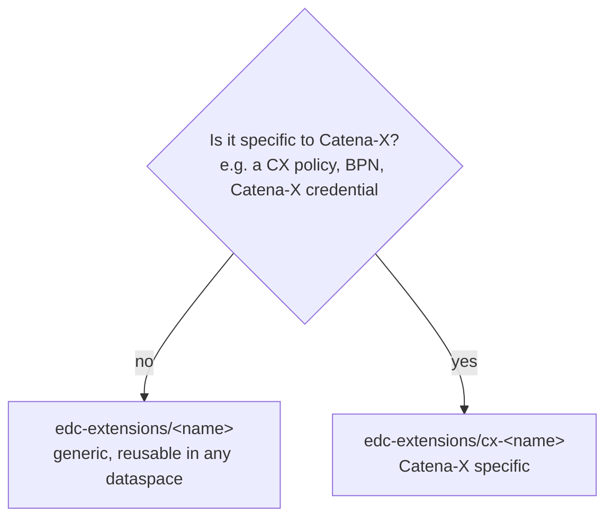

# Tutorial 4: Write your first extension

Everything in a connector, from the Management API to policy functions, is an **extension**. In this tutorial you
create one, give it a setting, test it and ship it in the control plane.

**Time:** about 30 minutes. **You need:** JDK 21, Git and a clone of this repository (see
[Developer setup](../developer/setup.md)).

## 1. Decide where it lives



Tractus-X EDC separates generic features from dataspace-specific rules, such as those of Catena-X, so that the
connector can serve other dataspaces too.
The rule is explained in the
[multi-dataspace support ADR](../development/decision-records/2026-01-07_multi-dataspace-support/README.md).
Our example is generic.

## 2. Scaffold the module

```bash
.claude/skills/new-extension/scripts/scaffold-extension.sh \
  edc-extensions/hello-world org.eclipse.tractusx.edc.hello HelloWorldExtension tx.edc.hello
```

You get:

```text
edc-extensions/hello-world/
├── README.md
├── build.gradle.kts
└── src
    ├── main
    │   ├── java/org/eclipse/tractusx/edc/hello/HelloWorldExtension.java
    │   └── resources/META-INF/services/org.eclipse.edc.spi.system.ServiceExtension
    └── test/java/org/eclipse/tractusx/edc/hello/HelloWorldExtensionTest.java
```

The `META-INF/services` file is how the runtime **finds** your extension: it lists the class name.

## 3. Read the extension

```java
@Extension(value = NAME)
public class HelloWorldExtension implements ServiceExtension {

    public static final String NAME = "Hello World Extension";

    static final String HELLO_WORLD_ENABLED = "tx.edc.hello.enabled";

    @Setting(key = HELLO_WORLD_ENABLED, description = "Enables the HelloWorld feature", defaultValue = "false")
    private boolean enabled;                       // (1)!

    @Inject
    private Monitor monitor;                       // (2)!

    @Override
    public void initialize(ServiceExtensionContext context) {
        if (!enabled) {
            monitor.debug("%s is disabled".formatted(NAME));
            return;
        }
        monitor.info("Hello, dataspace!");         // (3)!
    }
}
```

1.  `@Setting` injects the configuration value. Operators set it as `tx.edc.hello.enabled` or the environment variable
    `TX_EDC_HELLO_ENABLED`.
2.  `@Inject` gets a service another extension provides. The runtime orders extensions so that providers start first.
3.  Replace the scaffold's `TODO` with this line. In real extensions you register services, policy functions,
    transformers or API controllers here.

To **offer** a service to other extensions, add a method annotated with `@Provider` that returns it. Use
`@Provider(isDefault = true)` for a fallback that another extension may replace.

## 4. Register and build

Add the module to `settings.gradle.kts`, next to related modules:

```kotlin
include(":edc-extensions:hello-world")
```

Then build it. This compiles, runs Checkstyle and the generated unit test:

```bash
./gradlew :edc-extensions:hello-world:build
```

The generated test uses EDC's `DependencyInjectionExtension`, which creates the extension with mocked dependencies:

```java
@ExtendWith(DependencyInjectionExtension.class)
class HelloWorldExtensionTest {
    @Test
    void initialize(ServiceExtensionContext context, HelloWorldExtension extension) {
        extension.initialize(context);
        assertThat(extension.name()).isEqualTo(HelloWorldExtension.NAME);
    }
}
```

## 5. Ship it in a runtime

An extension is active only if a runtime puts it on its classpath. Add it to the base module that every control plane
shares, `edc-controlplane/edc-controlplane-base/build.gradle.kts`:

```kotlin
implementation(project(":edc-extensions:hello-world"))
```

Build the image and look for your log line:

```bash
./gradlew :edc-controlplane:edc-controlplane-postgresql-hashicorp-vault:dockerize
```

Deploy it with `TX_EDC_HELLO_ENABLED=true` (for example via `controlplane.env` in the Helm chart).

## 6. Before you open a pull request

- [ ] Fill in the module `README.md`, including a settings table.
- [ ] If operators need the setting, expose it in the Helm chart (see [Configuration](../deployment/configuration.md)).
- [ ] New third-party libraries pass the Eclipse Dash license check.
- [ ] Read [Contributing](../developer/contributing.md).

**Go deeper:** [Writing extensions](../developer/extensions.md) and
[Code architecture](../developer/code-architecture.md).

## NOTICE

This work is licensed under the [CC-BY-4.0](https://creativecommons.org/licenses/by/4.0/legalcode).

- AI Disclosure: This file was entirely AI-generated. The AI-generated portions are made available under CC0-1.0 and
  not subject to the project's license. The human contributor has reviewed and verified that the content is correct.
- SPDX-License-Identifier: CC-BY-4.0 AND CC0-1.0
- SPDX-FileCopyrightText: 2026 Catena-X Automotive Network e.V.
- SPDX-FileCopyrightText: 2026 Contributors to the Eclipse Foundation
- Assisted-By: GitHub Copilot (claude-opus-5.5)
- Source URL: <https://github.com/eclipse-tractusx/tractusx-edc>
