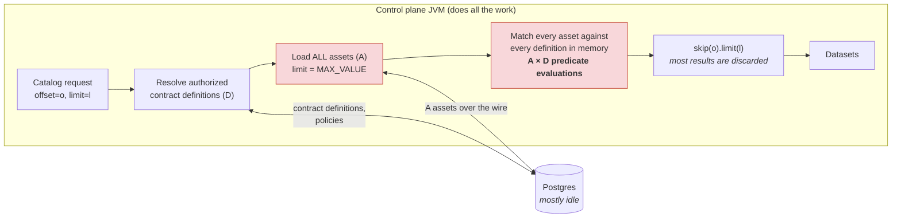
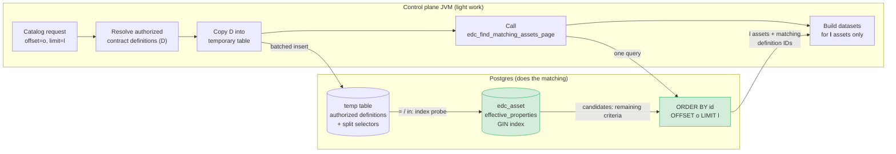
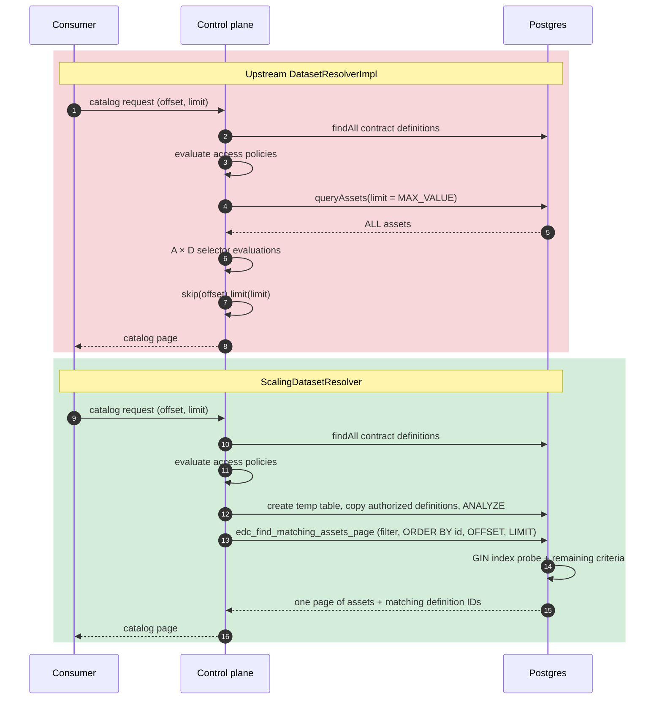
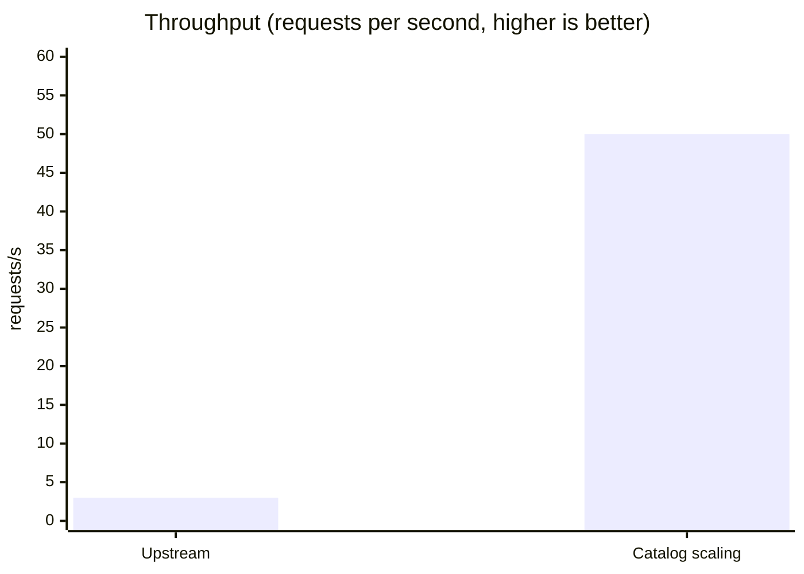
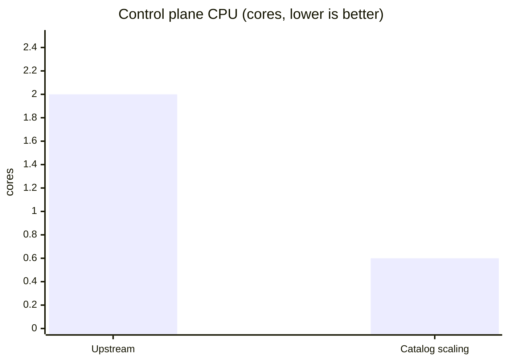
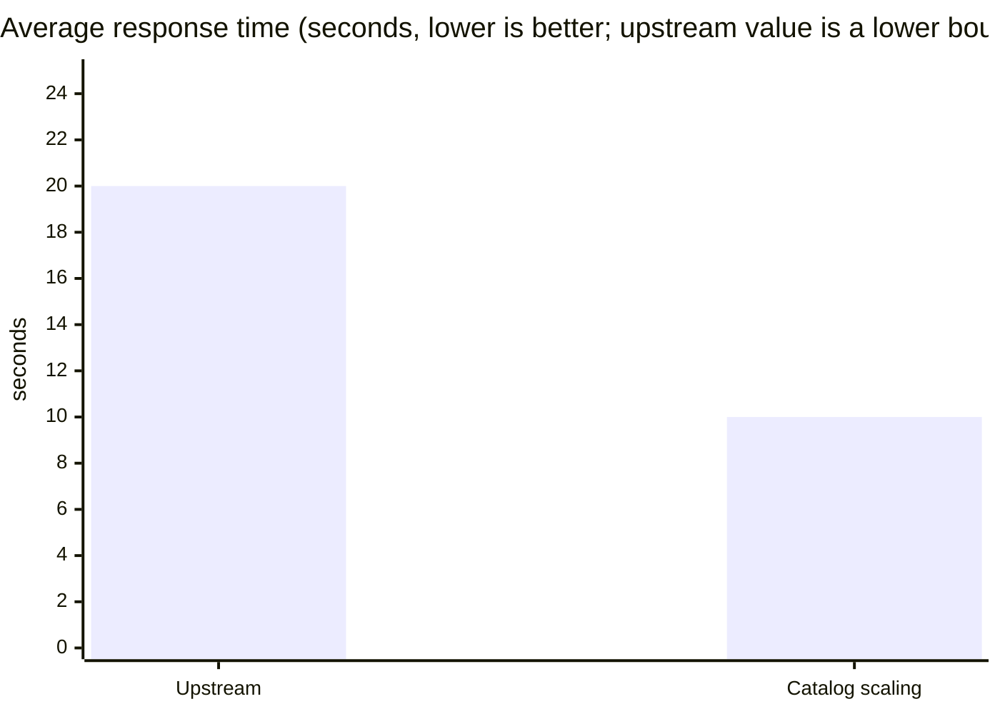
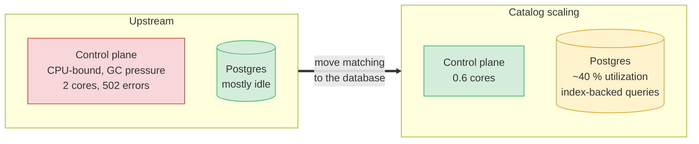

<!--
 AI Disclosure: This file was largely AI-generated. The AI-generated
 portions are made available under CC0-1.0 and not subject to the
 project's licence. The human contributor has reviewed and verified
 that the content is correct.

 SPDX-License-Identifier: CC-BY-4.0 AND CC0-1.0
 Assisted-by: GitHub Copilot (Claude-Opus-5.5)
-->

# Catalog Performance: What the Catalog Scaling Extension Changes

This document explains why catalog requests become slow with the upstream `DatasetResolver`, what this extension does
differently, and what the initial load tests show. For the functional description of the extension, see the
[README](../README.md).

## TL;DR

| Aspect                         | Upstream `DatasetResolverImpl`                               | `ScalingDatasetResolver` (this extension)                       |
|--------------------------------|--------------------------------------------------------------|-----------------------------------------------------------------|
| Where assets are matched       | Control plane JVM, in memory                                 | Postgres, inside a single query                                 |
| Assets loaded per request      | **All** assets matching the filter (`limit(MAX_VALUE)`)      | Only the requested page (`offset`/`limit` pushed into SQL)      |
| Selector evaluation            | Every asset × every authorized contract definition           | `=` / `in` criteria via GIN index probe, rest only on candidates |
| Paging (`offset`/`limit`)      | Applied **after** all datasets were built (`skip`/`limit`)   | Applied by Postgres, ordered by asset `id` for stable pages     |
| Control plane CPU and memory   | Grows with number of assets × contract definitions           | Grows with page size                                            |
| Horizontal scaling             | Limited, each pod repeats the full work                      | Scales with database capacity                                   |

Measured in the initial load tests (see [Load test results](#load-test-results)): roughly **16× more requests per
second**, **less than a third of the control plane CPU** and **about half the response time**.

## Why the Upstream Implementation Is Slow at Scale

In EDC 0.17.0, `DatasetResolverImpl.query(...)`
(`org.eclipse.edc:control-plane-catalog:0.17.0` →
`org/eclipse/edc/connector/controlplane/catalog/DatasetResolverImpl.java`) does the following:

1. It queries the asset index with `offset(0).limit(MAX_VALUE)` (line 76), so **every** asset of the participant
   context that matches the request filter is loaded from the database and materialized as a Java object.
2. For each asset, it tests the asset selector of **every** authorized contract definition by building Java predicates
   (lines 124-126). The number of predicate evaluations is therefore *assets × contract definitions × criteria*.
3. Only afterwards it applies the requested page with `skip(offset)` and `limit(limit)` (lines 83-84).

In Catena-X, assets and contract definitions are typically created in a 1:1 relation. With *N* assets, a single
catalog request therefore performs about *N²* selector evaluations, independent of the requested page size. Requesting
the first 10 datasets costs the same as requesting all of them.

The consequences are visible in the load tests: high CPU and heavy garbage collection on the control plane pod, a
database that is mostly idle, response times above 20 seconds, and HTTP 502 errors as parallelism grows. Adding more
pods does not help much, because every pod repeats the full *A × D* work for every request.

## What This Extension Does Instead

The `ScalingDatasetResolver` keeps the authorization step (resolving which contract definitions the requesting
participant may see) exactly as upstream, but moves the matching of assets and contract definitions into Postgres:

- **Precomputation on write, not on read.** Asset selectors are split into an index-friendly part (`=` and `in`) and
  the remaining criteria by a trigger whenever a contract definition is inserted or updated. The effective properties
  of an asset are stored in a generated column. No catalog request has to repeat this work.
- **Index probe instead of a full scan.** The `=` / `in` part of each selector is evaluated as a JSON containment check
  against a GIN index on `edc_asset.effective_properties`
  ([script.sql](../src/main/resources/sql/script.sql), `idx_edc_asset_effective_props_gin`). Only the candidate
  assets returned by the index are checked against the remaining criteria.
- **Paging in the database.** `offset`, `limit` and the request filter are part of the SQL query, ordered by asset
  `id` ([ScalingDatasetResolver.java](../src/main/java/org/eclipse/tractusx/edc/catalog/ScalingDatasetResolver.java)).
  Only the requested page of assets travels to the control plane.
- **Request-scoped temporary table.** The authorized contract definitions are copied in batches into a temporary table
  that Postgres drops automatically on commit or rollback, and `ANALYZE` gives the query planner accurate statistics.

### Where the work happens

## Load Test Results

Initial load tests sent several catalog requests per second to a single control plane pod and tracked the pod's CPU
and memory usage as well as the database utilization. The database was a PostgreSQL instance with 8 CPU cores and
32 GB RAM. For the upstream implementation, the JVM was tuned and the pod's CPU and memory were increased.

|                      | Upstream implementation | This extension | Change                    |
|----------------------|-------------------------|----------------|---------------------------|
| Pod CPU              | 2 cores                 | 0.6 cores      | **-70 %**                 |
| Requests/second      | max. 3                  | ~ 50           | **~ 16× more throughput** |
| Avg. response time   | > 20 s                  | ~ 10 s         | **at least -50 %**        |
| Database utilization | mostly idle             | ~ 40 %         | load moved to Postgres    |

### How the load shifts

### Reading the numbers

- **Throughput is the main gain.** Freeing the control plane from the *A × D* matching lets one pod serve about 16
  times more requests per second. Database load now grows with request parallelism, so capacity can be added where
  the work actually happens (Postgres CPU and memory; the temporary table requires a writable primary) instead of
  adding control plane pods that would each repeat the full matching.
- **Response time still depends on the database.** About 10 seconds at ~50 requests per second is measured under
  load. The response time depends on the authorization step, which still runs in the control plane, and on the
  index-backed query, so it is influenced by the number of contract definitions and by the database sizing.
- **The index fast path matters.** The largest gains come from selectors that use `=` or `in`, which is the common
  1:1 asset-to-contract-definition pattern. Selectors with only other operators (for example `like`, `<`, `!=`) are
  still evaluated in Postgres and still benefit from paging in the database, but without the index probe.

### Caveats

- These are **initial** load test results reported by the authors of the extension. The exact numbers of assets and
  contract definitions and the request mix are not part of this document; your results depend on these, on the
  selector operators in use, and on the database sizing.
- The authorization step (resolving and evaluating access policies for all contract definitions) is unchanged from
  upstream and still runs in the control plane.
- The known functional divergences from the Java-based matching are listed in the
  [README](../README.md#known-divergences-from-java-based-implementation).

## NOTICE

This work is licensed under the CC-BY-4.0

- SPDX-License-Identifier: CC-BY-4.0
- SPDX-FileCopyrightText: 2026 Contributors to the Eclipse Foundation
- Source URL: https://github.com/eclipse-tractusx/tractusx-edc
