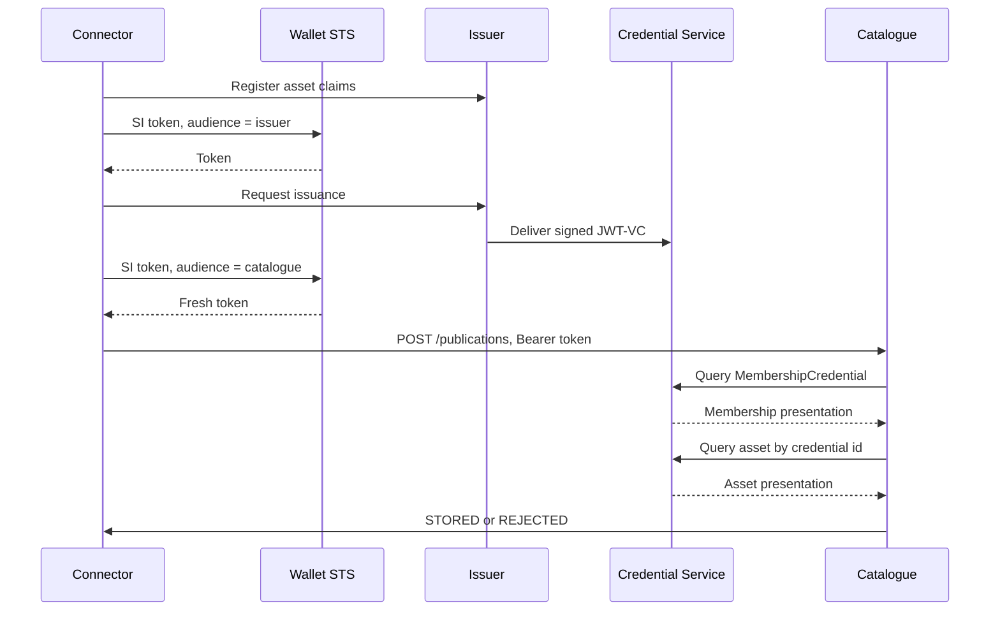

# XFSC Catalogue extension

Publishes a new connector asset to the [Construct-X Federated Catalogue](https://github.com/project-construct-x/federated-catalogue) over DCP. The catalogue is the verifier. Signing and presentation happen in the [Construct-X IdentityHub](https://github.com/project-construct-x/IdentityHub) (`develop`). Design only — see [PLAN.md](PLAN.md).

There is no catalogue credential type for "an EDC asset". Two different credentials are involved:

- **`MembershipCredential`** — already issued to the wallet by `did:web:issuer.int.construct-x.net:issuer`. The catalogue pulls this to decide who is calling. It is not the asset. Claims are `isConsumer` / `isProvider` ([fixture](https://github.com/project-construct-x/federated-catalogue/blob/dev/examples/construct-x-registry-demo/membership-credential-v2.jsonld)).
- **The asset itself** — a separate VC the catalogue already stores via `POST /assets`: a Gaia-X `ServiceOffering`, `DataProduct`, `Resource`, or `LegalPerson` (`https://w3id.org/gaia-x/2511#…`), or another JWT-VC (`application/vc+jwt`). Self-publish requires the asset `issuer` to equal the membership subject DID. JSON-LD with a Linked Data Proof is rejected.

On asset create (`cx.catalogue.publish=true`):

1. The participant issuer signs that asset VC (not a membership credential).
2. The connector sends a fresh Self-Issued ID Token to `POST /publications`. The body names the credential id and its real type.
3. The catalogue checks the token, pulls `MembershipCredential`, then pulls the asset VC from `POST {credentials}/v1/participants/{id}/presentations/query`.
4. It stores the VC and reports `STORED` or `REJECTED`.

Per the [DCP spec](https://eclipse-dataspace-dcp.github.io/decentralized-claims-protocol/v1.0.1/), the query carries **either** a scope **or** a presentation definition. Normative scopes are `org.eclipse.dspace.dcp.vc.type:<Type>` and `org.eclipse.dspace.dcp.vc.id:<id>` (no `:read` segment). This IdentityHub build still only answers the older `org.eclipse.edc.vc.type:<Type>:read` and rejects `presentationDefinition`.
